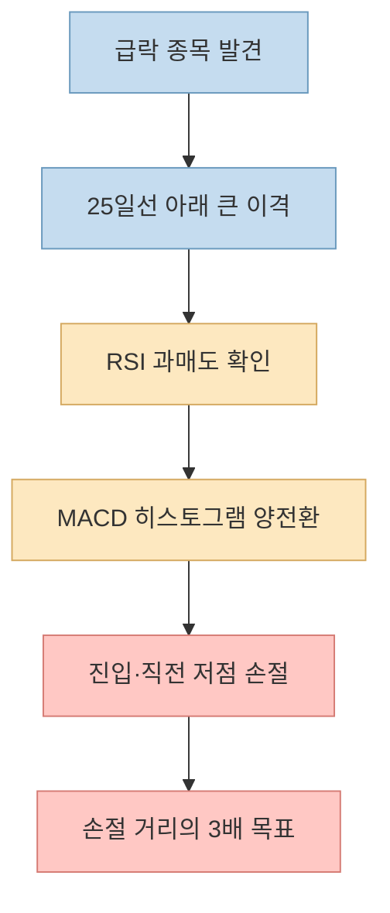
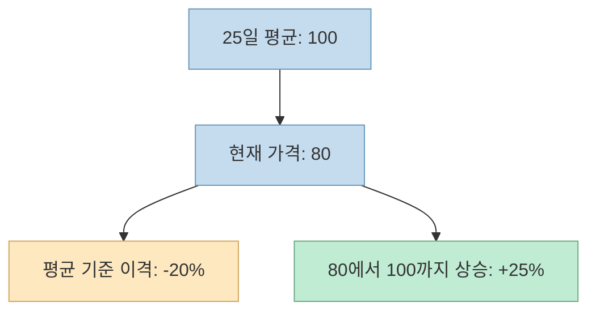
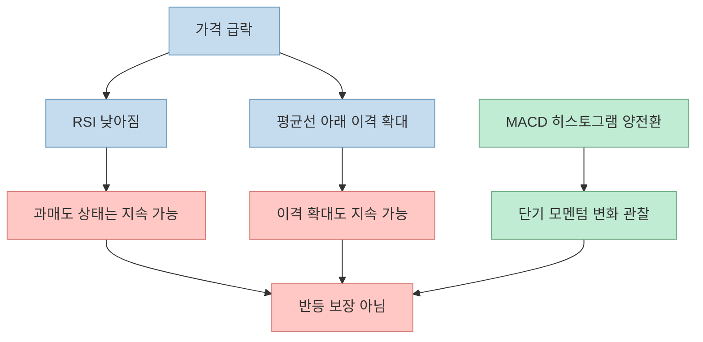
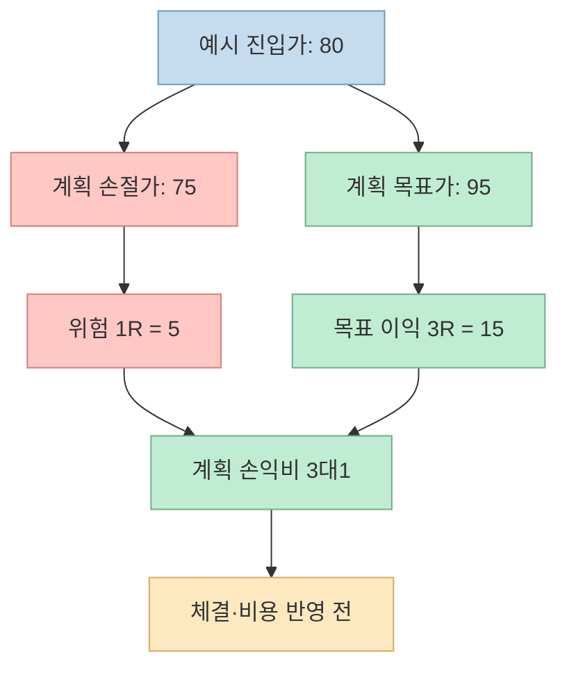

"2천만 원을 4천억 원으로 만든 트레이더의 매매법"이라는 제목의 쇼츠는 일본 트레이더 BNF의 역추세 전략을 **25일 지수이동평균선(EMA)에서 20% 이상 이격 → RSI 과매도 → MACD 히스토그램 양전환 → 매수** 라는 공식으로 제시합니다. 그러나 **BNF가 이 네 조건을 실제로 한 세트로 사용했다는 근거** 와 **이 조합이 수익을 낸다는 검증** 은 별개의 문제입니다. 영상을 출발점으로 삼되, 확인되는 사실과 현대적으로 덧붙인 규칙을 나눠 보겠습니다.

<!--more-->

## Sources

- [YouTube Shorts 원본 — 박한결, 「2천만원을 4천억으로 만든 일본의 천재 트레이더 BNF」](https://youtube.com/shorts/ubsoA7Hb-D8?si=aVw5IHimmQifEubm) — 한국어 자동 생성 자막을 시간대별로 확인했습니다. 제목·작성자는 YouTube의 공개 oEmbed 메타데이터로 대조했습니다.
- [BNF 명의 2004년 게시글을 보존한 아카이브](https://w.atwiki.jp/e9g92z/pages/33.html) — 게시글 복제본으로, 원본 계정의 신원을 독립적으로 인증한 자료는 아닙니다.
- [TradingView: EMA의 정의와 계산](https://www.tradingview.com/support/solutions/43000592270-exponential-moving-average/)
- [Fidelity: RSI 설명](https://www.fidelity.com/learning-center/trading-investing/technical-analysis/technical-indicator-guide/RSI)
- [TradingView: MACD 및 히스토그램 설명](https://www.tradingview.com/support/solutions/43000502344-moving-average-convergence-divergence-macd-indicator/)
- [SEC Investor.gov: 손절 주문의 체결 위험](https://www.investor.gov/introduction-investing/general-resources/news-alerts/alerts-bulletins/investor-bulletins-15)

## 1. 쇼츠가 실제로 말하는 매매 순서

영상은 세 지표를 차트에 추가하라고 합니다. [약 11초](https://youtu.be/ubsoA7Hb-D8?t=11)부터 25일 EMA, RSI, MACD를 설정하고, [약 24초](https://youtu.be/ubsoA7Hb-D8?t=24)부터 급락 구간과 25일선 대비 20% 이상의 이격을 찾습니다. [약 32초](https://youtu.be/ubsoA7Hb-D8?t=32)에는 RSI의 과매도, [약 36초](https://youtu.be/ubsoA7Hb-D8?t=36)에는 MACD 히스토그램이 0선을 넘어 양수로 바뀌는 것을 진입 조건으로 제시합니다. 이어 [약 40초](https://youtu.be/ubsoA7Hb-D8?t=40)에는 직전 저점 손절, 손절 거리의 세 배를 목표 수익으로 삼으라고 설명합니다.

영상은 [약 5초](https://youtu.be/ubsoA7Hb-D8?t=5)에 "오직 이격도 하나"라는 취지로 말하지만, 실제 제시하는 진입 조건에는 RSI와 MACD가 추가됩니다. 이는 설명상의 긴장입니다. **이격도를 먼저 살피는 전략** 과 **세 지표의 동시 충족을 기다리는 전략** 은 후보 종목·진입 시점·거래 횟수가 달라질 수 있습니다. 영상만으로 어느 쪽이 BNF의 실제 기록과 일치하는지 증명할 수 없습니다.

## 2. 20% 이격은 무엇을 뜻하나: ‘아래로’와 평균의 종류가 중요하다

이격도는 보통 `현재 종가 ÷ 이동평균값 − 1`로 계산합니다. 평균이 100이고 종가가 80이면 **−20% 이격** 입니다. 여기서 "20% 이상 벌어졌다"는 절댓값만 말하면 위로 20% 올라간 종목까지 섞이므로, 역추세 매수 맥락에서는 **25일선보다 아래로 이격** 됐는지 방향을 명시해야 합니다. 종가 80이 평균 100으로 돌아가려면 20%가 아니라 종가 기준 **25% 상승** 이 필요합니다. 이는 분모가 달라서 생기는 산술 차이입니다.

또 하나는 **SMA와 EMA의 차이** 입니다. 영상은 [약 13초](https://youtu.be/ubsoA7Hb-D8?t=13)에 25일 **지수** 이동평균선 설정을 안내합니다. EMA는 최근 가격에 더 큰 가중치를 부여하므로 단순이동평균선(SMA)과 값·신호 날짜가 달라질 수 있습니다. [TradingView의 EMA 설명](https://www.tradingview.com/support/solutions/43000592270-exponential-moving-average/)을 보면 이 차이가 분명합니다. 반면 BNF 명의 게시글 복제본은 **25일 이동평균선** 이라고만 적어 SMA인지 EMA인지 특정하지 않습니다. 따라서 "BNF가 25일 EMA를 썼다"고 확정할 수 없습니다. [BNF 게시글 아카이브](https://w.atwiki.jp/e9g92z/pages/33.html)

더 중요한 사실은 **−20%가 시대와 종목을 가리지 않는 고정 매수선이 아니라는 점** 입니다. BNF 명의로 보존된 [2004년 글](https://w.atwiki.jp/e9g92z/pages/33.html)은 2001~2002년의 심한 하락장에서는 25일선 대비 큰 음의 이격을 봤지만, 다른 장세에는 더 작은 이격에서 반등했다고 설명합니다. 같은 자료는 업종·종목군·유동성·시장 상황에 따라 기준을 다르게 잡아야 하고 **이격 숫자만 보고 역추세 매수하는 것은 권하지 않는다** 는 취지도 담고 있습니다. 다만 이는 제삼자가 보존한 게시글이므로 작성자 신원과 수치의 원본성에는 한계가 있습니다.

## 3. RSI와 MACD는 무엇을 확인하며, 무엇을 증명하지 못하나

영상은 [약 32초](https://youtu.be/ubsoA7Hb-D8?t=32)에 RSI가 과매도여야 한다고 말하지만 기간과 임계값은 지정하지 않습니다. 전통적으로 RSI 30 이하는 과매도로 해석되지만, 강한 하락 추세에서는 **오랫동안 과매도에 머물 수 있습니다**. 따라서 RSI가 낮다는 사실은 "이미 많이 하락했다"는 관찰에 가깝지, 반등이 곧 시작된다는 보장은 아닙니다. [Fidelity RSI 안내](https://www.fidelity.com/learning-center/trading-investing/technical-analysis/technical-indicator-guide/RSI)

MACD 부분도 정확히 읽어야 합니다. [약 36초](https://youtu.be/ubsoA7Hb-D8?t=36)의 "히스토그램이 영선 위의 녹색 막대로"라는 설명을 수치로 바꾸면 `히스토그램 = MACD선 − 신호선`이 음수에서 양수로 바뀌는 순간입니다. 이는 **MACD선이 신호선을 위로 돌파했다** 는 뜻이지, MACD선 자체가 0 위에 올라왔다는 뜻은 아닙니다. 막대의 녹색·적색은 차트 테마와 표시 설정에 따라 달라질 수 있으니 **색보다 수치의 부호** 를 확인해야 합니다. [TradingView MACD 설명](https://www.tradingview.com/support/solutions/43000502344-moving-average-convergence-divergence-macd-indicator/)

확인한 BNF 명의 게시글에는 이격도와 시장 상황에 관한 설명은 있으나 **RSI·MACD를 동시에 사용해야 한다는 규칙은 확인되지 않았습니다**. 따라서 영상의 세 지표 결합은 원래 매매법의 검증된 복원이라기보다 **영상 제작자가 제안한 현대적 재구성** 으로 다루는 것이 안전합니다. 이 문장은 "BNF가 절대 RSI·MACD를 쓰지 않았다"는 주장도 아닙니다. 자료에 없는 것을 확정하지 않는다는 뜻입니다. [BNF 게시글 아카이브](https://w.atwiki.jp/e9g92z/pages/33.html)

## 4. 직전 저점 손절과 ‘3배 수익’의 계산은 깔끔하지만 실제 체결은 다르다

영상의 [마지막 규칙](https://youtu.be/ubsoA7Hb-D8?t=40)은 진입가와 손절가 사이의 가격 차이를 `1R`로 두고, 진입가보다 `3R` 높은 곳을 목표로 잡는 **계획상 손익비 3:1** 입니다. 예를 들어 80에 진입하고 직전 저점 아래인 75를 손절 가격으로 정했다면 `1R = 5`, 목표 가격은 95입니다. 이는 "투자금이 세 배가 된다"는 뜻이 아니라 **가격 위험 5에 대해 목표 이익 15를 노린다** 는 뜻입니다.

수수료·세금·미끄러짐을 빼고, 모든 거래가 정확히 `−1R` 또는 `+3R`로 끝난다고 가정하면 승률 25%가 손익분기점입니다. 하지만 현실에서는 목표가에 도달하지 못한 채 되돌아가거나, 손절가를 지나 낮게 체결될 수 있습니다. SEC는 손절 주문의 **설정 가격이 실제 체결 가격을 보장하지 않는다** 고 설명합니다. [SEC 손절 주문 안내](https://www.investor.gov/introduction-investing/general-resources/news-alerts/alerts-bulletins/investor-bulletins-15) 따라서 3:1은 매매 계획의 형태일 뿐, 전략의 기대수익이나 성공률을 증명하지 않습니다.

## 실전 적용 포인트: 이 영상을 검증하려면

1. **규칙을 먼저 고정한다.** 25일 SMA인지 EMA인지, RSI 기간·과매도 기준, MACD 설정, 종가 기준인지 장중 기준인지 명시한다.
2. **시대와 시장을 나눈다.** 2001년 일본 하락장에서 언급된 이격 기준을 2026년 다른 시장에 그대로 옮기지 않는다.
3. **탈락한 거래도 기록한다.** 후보 발견 뒤 더 떨어진 경우, RSI가 낮은 채 지속된 경우, MACD가 반복해서 양·음으로 바뀐 경우를 모두 포함한다.
4. **순성과로 검증한다.** 실제 체결가·거래 비용·미체결·생존자 편향을 반영한 뒤, 단순한 이격도 규칙과 영상의 세 지표 결합을 따로 비교한다.

## 핵심 요약

- 영상은 [25일 EMA·−20% 이격·RSI 과매도·MACD 히스토그램 양전환](https://youtu.be/ubsoA7Hb-D8?t=11)을 하나의 진입 공식으로 제시합니다.
- 과거 BNF 명의 게시글에서 확인되는 것은 **25일선 이격과 시장 상황에 따른 유동적 판단** 입니다. EMA 선택과 RSI·MACD 동시 조건은 확인되지 않습니다.
- `3R` 목표는 수익 보장이 아닙니다. 손절 체결 위험과 거래 비용을 반영해 별도 검증해야 합니다.

## 결론

쇼츠는 **이격도 기반 역추세 매매를 이해하는 입문 사례** 로는 흥미롭습니다. 하지만 유명 트레이더의 이름, 큰 수익금 제목, 여러 지표의 동시 충족만으로 규칙의 진위나 재현성을 보장할 수는 없습니다. 먼저 원자료와 계산 정의를 고정하고, 실패한 거래까지 포함해 검증하세요. 이 글은 전략 분석이며 특정 종목의 매수·매도 권유가 아닙니다.
