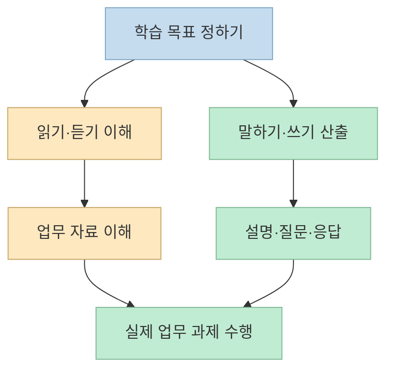
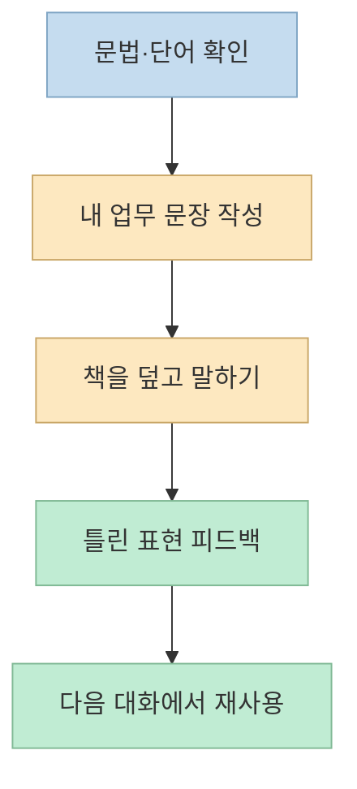
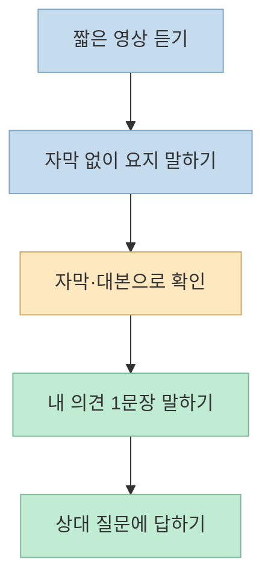

유학을 가지 않아도 영어를 공부할 수 있다는 조언은 실용적이다. 하지만 문법책 한 권, 단어 10개, 영상 시청, 토익 문제풀이를 모두 한다고 해서 **업무 상황에서 바로 말할 수 있게 된다는 보장** 은 없다. 한 Threads 글의 다섯 가지 추천을 각각 어떤 능력을 연습하는 도구인지 나눠 보고, 빠진 연습 고리를 채워 보자.

<!--more-->

## Sources

- [원문: 유학·연수 없이 영어를 공부하는 방법 5가지](https://www.threads.com/share/BAELBJBUP4/) — 문법책, 전화·화상영어, 토익 단어, 영상 듣기, 무료 LC/RC 문제를 제안한다.
- [Cambridge: English Grammar in Use](https://shop.cambridge.org/english/family/2100045418), [British Council: 말하기 연습 자료](https://learnenglish.britishcouncil.org/free-resources/speaking)
- [민트영어 공식 사이트](https://story.mint05.com/), [슈퍼팬 앱 소개](https://apps.apple.com/kr/app/%EC%8A%88%ED%8D%BC%ED%8C%AC/id1139458445), [해커스 토익 기출보카](https://www.hackersbook.com/book/detail/208), [해커스토익 앱 소개](https://apps.apple.com/kr/app/%ED%95%B4%EC%BB%A4%EC%8A%A4%ED%86%A0%EC%9D%B5-toeic/id430260350)
- [ETS: TOEIC Listening & Reading](https://www.ets.org/toeic/about/listening-reading.html), [ETS: TOEIC Speaking & Writing](https://www.ets.org/toeic/about/speaking-writing.html), [Cambridge English: 직장 영어 수준별 수행 능력](https://www.cambridgeenglish.org/educators-organisations/accept-verify-exams/employers/workplace-english-exams/)

## 먼저 목표를 분해하자: 영어 공부와 업무 회화는 다르다

원문은 다섯 가지를 꾸준히 하면 비즈니스 영어회화가 가능하다고 말한다. 그러나 ‘가능하다’가 **짧은 자기소개**, **회의에서 의견 제시**, **고객과 즉석 질의응답** 중 무엇을 뜻하는지 정하지 않으면 성과를 검증할 수 없다. [Cambridge English의 직장 영어 안내](https://www.cambridgeenglish.org/educators-organisations/accept-verify-exams/employers/workplace-english-exams/)는 예컨대 B2 수준에서 회의 토론을 듣고 기여하는 능력을, C1 수준에서는 회의·발표에 자신 있게 참여하는 능력을 구분한다. 이는 목표를 구체화하는 참고 기준이지, 특정 자료를 몇 주 사용하면 그 수준에 도달한다는 뜻은 아니다.

따라서 학습 전에 ‘영어로 주간 업무를 1분 설명하고 후속 질문 2개에 답하기’처럼 **관찰 가능한 과제** 를 하나 정하자. 아래 계획은 이 과제를 위한 연습 설계 예시이며, 특정 수준의 도달 기간을 약속하는 처방은 아니다.

## 1·3번: 문법책과 하루 10단어는 입력 재료다

원문의 1번은 *Grammar in Use*를 한 달 공부하는 것이다. [Cambridge가 소개하는 *English Grammar in Use*](https://shop.cambridge.org/english/family/2100045418)는 중급 학습자를 위한 자습용 문법 참고·연습서다. 시리즈에는 수준과 영어 변종이 다른 판본도 있으므로 **자신의 현재 수준과 필요한 영어** 에 맞춰 고르는 것이 먼저다. ‘한 달’은 원문 작성자의 목표 기간일 뿐, 모든 학습자에게 적용되는 공식 완성 기간이나 업무 회화 달성 기준은 아니다.

문법을 읽고 문제를 맞혔다면 그 구조로 **내 업무 문장 하나를 직접 만들어 말해 보자**. 예를 들어 조건문을 공부한 날에는 일정 변경을 설명하는 문장, 요청 표현을 공부한 날에는 회의 일정 조정을 부탁하는 문장을 만든다. 지식 확인에서 실제 발화로 넘어가는 연습이 필요하다는 판단은 **문법 문제풀이와 업무 발화가 서로 다른 과제** 라는 점에서 나온 실천적 제안이다.

원문의 3번은 해커스 토익 단어장을 하루 10개씩 외우는 것이다. [해커스의 기출보카 소개](https://www.hackersbook.com/book/detail/208)는 토익 어휘와 연계 학습자료를 제공한다. 다만 토익에서 자주 나오는 단어가 곧 **내 직무에서 자주 말해야 하는 표현** 인 것은 아니다. 새 단어의 뜻을 외운 뒤 ‘회의에서 한 번 쓸 문장’을 만들고, 실제 대화에서 사용했는지를 별도로 체크하자. 10개라는 개수보다 **의미를 떠올려 써 보는지** 가 중요하다.

## 2·4번: 회화와 영상 듣기는 함께 써야 한다

원문의 2번인 [민트영어](https://story.mint05.com/)는 전화·화상 1:1 수업을 제공하는 상용 서비스다. 이 서비스가 유일한 정답이라는 근거는 없다. 비용을 쓰기 전 **수업 시간, 실제 발화량, 강사의 교정 방식, 수업 후 복습자료** 를 확인하고 체험 수업에서 자신의 업무 상황을 다뤄 보자. 무료 또는 저비용 대안으로도 [British Council의 수준별 말하기 자료](https://learnenglish.britishcouncil.org/free-resources/speaking/)처럼 직장 대화 영상과 연습 활동을 활용할 수 있다.

원문의 4번은 슈퍼팬 앱 또는 ‘올띵킹’ 유튜브 채널이다. [슈퍼팬 앱 소개](https://apps.apple.com/kr/app/%EC%8A%88%ED%8D%BC%ED%8C%AC/id1139458445)는 영상, 자막, 받아쓰기·따라 말하기 기능을 안내한다. 그러나 **영상을 보기만 하는 것과 처음 듣는 말을 알아듣거나 대답하는 것은 다른 과제** 다. 짧은 영상을 고른 뒤 ① 자막 없이 핵심을 적고 ② 자막으로 놓친 표현을 확인한 뒤 ③ 같은 내용에 영어로 한 문장 답하는 식으로 듣기와 말하기를 연결하자.

‘올띵킹’이라는 이름의 공식 채널은 이번 확인에서 **정확히 특정하지 못했다**. 검색에서 비슷한 이름의 채널이 보이더라도 원문이 말한 채널과 동일하다고 단정할 수 없으므로, 채널을 찾을 때는 원문 작성자에게 정확한 링크를 확인하는 편이 안전하다.

## 5번: 토익 LC/RC는 회화의 대리 지표가 아니다

원문의 마지막 추천은 해커스토익의 매일 무료 LC/RC 문제다. [해커스토익 앱 소개](https://apps.apple.com/kr/app/%ED%95%B4%EC%BB%A4%EC%8A%A4%ED%86%A0%EC%9D%B5-toeic/id430260350)는 매일 LC/RC 학습 콘텐츠를 안내한다. 제공 범위와 무료 조건은 서비스에서 이용 전 다시 확인해야 한다. 문제를 풀면 듣기·읽기 이해와 시험 유형을 점검할 수 있지만, 점수만으로 업무 회화 능력이 입증되는 것은 아니다.

[ETS의 TOEIC L&R 설명](https://www.ets.org/toeic/about/listening-reading.html)은 이 시험이 듣기와 읽기를 측정한다고 밝힌다. 말하기·쓰기는 [별도의 TOEIC Speaking & Writing](https://www.ets.org/toeic/about/speaking-writing.html)으로 평가한다. 따라서 목표가 회의 발언이라면 LC/RC 정답률과 별도로 **말한 내용이 전달됐는지, 후속 질문에 답했는지** 를 평가해야 한다.

## 실전 적용 포인트: 4주짜리 실험으로 점검하기

아래는 연구에서 보장한 일정이 아니라, 다섯 자료가 서로 연결되는지 살펴보는 **개인 실험 예시** 다.

1. **시작 전:** 자신에게 필요한 업무 상황 하나를 정하고, 1분 설명과 예상 질문 2개를 녹음한다.
2. **매일:** 수준에 맞는 문법 한 항목과 단어 소량을 고른 뒤, 업무 문장으로 만들어 책을 보지 않고 말한다.
3. **주 2~3회:** 짧은 영상의 요지를 듣고 말한다. 가능하면 상대방과 대화하거나 교정받는다. 유료 수업은 발화·피드백이 충분한지 확인한 후 선택한다.
4. **토익 목표가 있다면:** LC/RC 문제를 별도로 풀고 오답 유형을 기록한다. 회화 연습 시간을 전부 대체하지는 않는다.
5. **4주 후:** 같은 업무 과제를 다시 녹음해 설명의 명료성, 멈춤, 질문 응답을 비교한다. 개선이 없다면 자료를 더 늘리기보다 연습 방식과 피드백을 바꾼다.

## 핵심 요약

- 문법책과 단어장은 **표현의 재료**, 영상과 LC/RC는 주로 **이해 연습**, 대화와 피드백은 **말하기 연습** 에 가깝다.
- 원문의 ‘한 달’과 ‘하루 10개’는 학습량 제안이지, 비즈니스 회화 달성의 검증된 기준이 아니다.
- 회화가 목표라면 실제 업무 과제를 말해 보고, 상대 질문에 답하는 능력을 별도로 확인해야 한다.

## 결론

유학 없이도 공부를 시작하고 지속할 수 있다. 다만 다섯 자료를 모두 소비하는 것보다 **업무에 필요한 말을 정하고, 직접 말하고, 피드백을 받아 다시 써 보는 순환** 이 핵심이다. 원문의 목록은 출발점으로 삼되, 성과는 자신의 업무 과제로 검증하자.
