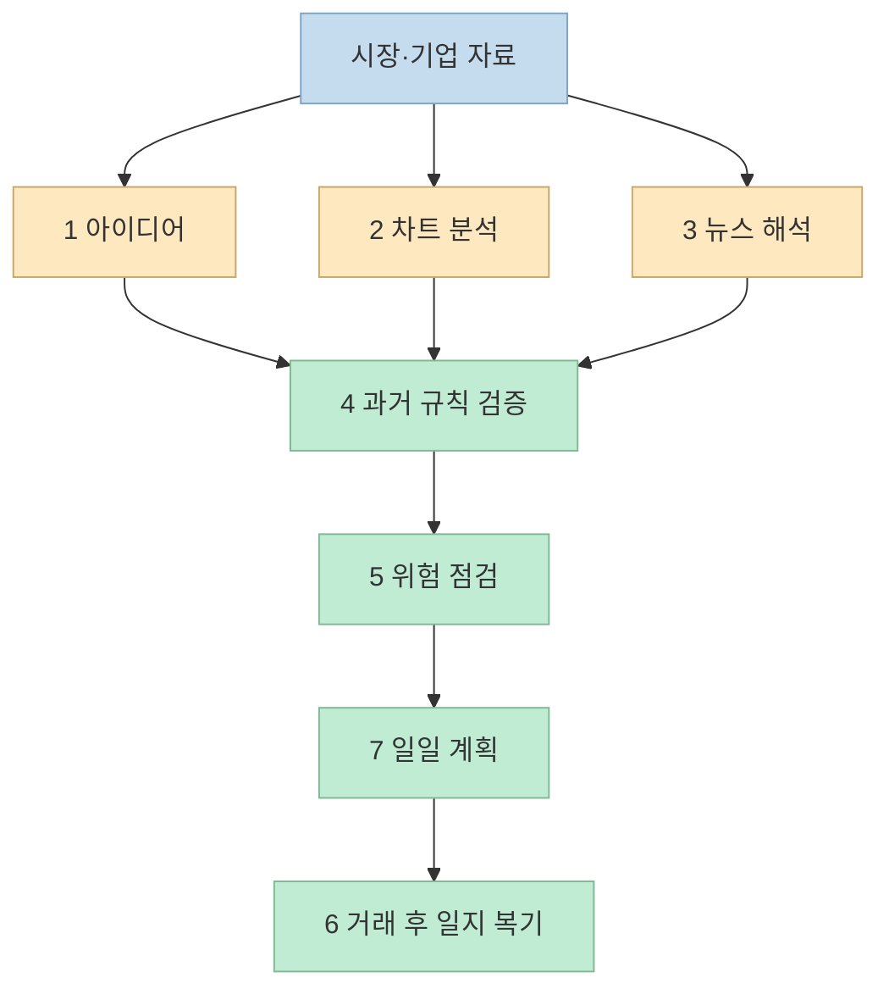
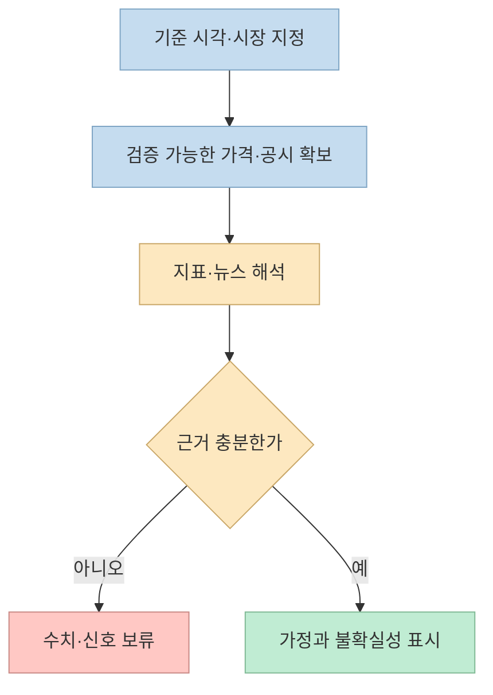
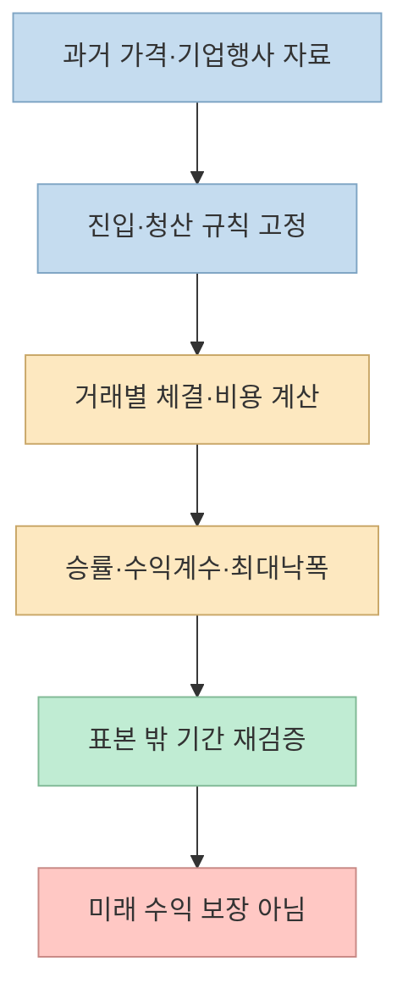

“ChatGPT로 주식 거래를 자동화하는 7개 명령어”라는 X 스레드가 있다. 아이디어 발굴부터 기술적 분석, 백테스트, 포트폴리오 점검까지 투자 과정의 거의 전부를 한 줄씩 요청한다. **프롬프트가 분석 과제를 정리해 주는 것** 과 **정확한 시세를 확보해 검증하거나 실제 주문을 실행하는 것** 은 별개의 일이다. 일곱 항목을 원문의 순서대로 살펴보자.

<!--more-->

## Sources

- [원문: X 스레드 첫 게시물](https://x.com/yapayaracIar/status/2109556570493264283) — 2026년 10월 12일 게시된 터키어 원문. 아래 일곱 개의 이어진 게시물을 함께 확인했다.
- [1. 거래 아이디어](https://x.com/yapayaracIar/status/2109556574897291462), [2. 기술적 분석](https://x.com/yapayaracIar/status/2109556581478113488), [3. 뉴스](https://x.com/yapayaracIar/status/2109556586201198937)
- [4. 백테스트](https://x.com/yapayaracIar/status/2109556590223237254), [5. 포트폴리오 위험](https://x.com/yapayaracIar/status/2109556594039980415), [6. 매매일지](https://x.com/yapayaracIar/status/2109556598041354696), [7. 일일 거래 계획](https://x.com/yapayaracIar/status/2109556601673613649)
- [OpenAI: ChatGPT 데이터 분석](https://help.openai.com/en/articles/8437071-data-analysis-with-chatgpt), [OpenAI: 외부 API를 연결하는 GPT Actions](https://help.openai.com/en/articles/9442513-gpt-actions-domain-settings-chatgpt-enterprise), [OpenAI: ChatGPT 금융 기능의 범위](https://help.openai.com/en/articles/20001222-finances-in-chatgpt)
- [미국 SEC·FINRA: AI 생성 투자정보 주의](https://www.investor.gov/introduction-investing/general-resources/news-alerts/alerts-bulletins/investor-alerts/artificial-intelligence-fraud), [FINRA: 백테스트의 한계](https://syndication.finra.org/content/smart-questions-ask-about-smart-beta-products-part-2), [미국 SEC: EDGAR 공시 확인](https://www.investor.gov/introduction-investing/getting-started/researching-investments/using-edgar-research-investments)

## 일곱 프롬프트는 무엇을 요청하나

원문은 ChatGPT를 ‘거래의 천재’로 소개하지만, 일곱 문장은 실제로 서로 다른 작업을 요청한다.

1. **거래 아이디어:** 오늘 시장에서 종목·지수·업종을 골라 진입가, 목표가, 손절가, 손익비를 포함한 다섯 시나리오를 만들어 달라는 요청이다. [원문 1번](https://x.com/yapayaracIar/status/2109556574897291462)
2. **기술적 분석:** 일간·주간 차트의 지지·저항, 추세선, 이동평균, 모멘텀을 보고 매수·보유·매도 신호를 내 달라는 요청이다. [원문 2번](https://x.com/yapayaracIar/status/2109556581478113488)
3. **뉴스 해석:** 기업·업종의 최신 뉴스를 요약하고 단기·장기 가격 영향과 포지션 방향을 제안해 달라는 요청이다. [원문 3번](https://x.com/yapayaracIar/status/2109556586201198937)
4. **전략 백테스트:** 이동평균 교차나 RSI 다이버전스 같은 규칙을 과거 자료에 적용해 승률·수익계수·최대낙폭을 계산해 달라는 요청이다. [원문 4번](https://x.com/yapayaracIar/status/2109556590223237254)
5. **포트폴리오 위험:** 보유 종목과 비중을 보고 집중·상관 위험을 찾고, 시장이 20% 하락하는 상황에 대비한 재조정을 제안해 달라는 요청이다. [원문 5번](https://x.com/yapayaracIar/status/2109556594039980415)
6. **매매일지 분석:** 최근 20건의 진입·청산과 결과에서 반복 실수 및 행동 편향을 찾고 개인 규칙 세 가지를 제안해 달라는 요청이다. [원문 6번](https://x.com/yapayaracIar/status/2109556598041354696)
7. **일일 거래 계획:** 장 시작 전부터 장마감까지 시간대별 체크리스트를 만들어 달라는 요청이다. 원문의 제목에는 ‘완전 자동’이 들어가지만 본문은 **계획표 작성** 을 요구한다. [원문 7번](https://x.com/yapayaracIar/status/2109556601673613649)

이 흐름에서 AI가 특히 유용한 부분은 **자료를 구조화하고 빠진 질문을 찾아내는 보조 작업** 이다. [OpenAI의 데이터 분석 안내](https://help.openai.com/en/articles/8437071-data-analysis-with-chatgpt)는 표 형식 파일을 분석하고 일부 작업에서 Python 계산을 수행할 수 있다고 설명한다. 동시에 입력 자료, 실행 코드, 계산 가정을 검토하라고 안내한다. 데이터가 없는데 요청만 길게 쓴다고 검증된 시세나 수익률이 생기지는 않는다.

## 1~3번: 오늘의 가격·차트·뉴스를 모르면 신호를 만들 수 없다

‘오늘의 시장’과 ‘최신 뉴스’는 시점이 핵심이다. 모델에 해당 시세·차트·뉴스가 제공되지 않았거나 실시간 정보에 접근하는 도구가 활성화되지 않았다면, 그럴듯한 진입가나 예상 변동 폭을 생성해도 **현재 시장을 분석한 결과로 볼 수 없다**. 먼저 거래소·데이터 제공처의 가격 자료와 기준 시각을 지정하고, 뉴스는 기사 원문뿐 아니라 기업의 공식 공시로 교차 확인해야 한다. 미국 상장기업의 공시를 찾는 출발점으로는 [SEC의 EDGAR 안내](https://www.investor.gov/introduction-investing/getting-started/researching-investments/using-edgar-research-investments)가 있다.

입력 자료가 있더라도 [1번의](https://x.com/yapayaracIar/status/2109556574897291462) ‘성공 확률이 높은 다섯 시나리오’는 **확률 모형, 표본, 검증 결과** 없이 숫자로 제시할 수 없다. [2번의](https://x.com/yapayaracIar/status/2109556581478113488) 매수·보유·매도 판단도 이동평균 기간이나 지지·저항 정의가 사람마다 달라질 수 있다. [3번의](https://x.com/yapayaracIar/status/2109556586201198937) 뉴스 영향 역시 이미 가격에 반영됐는지, 단기와 장기에 같은 방향으로 작용할지 별도 검증이 필요하다.

## 4번: 백테스트는 숫자 생성이 아니라 재현 가능한 계산이다

승률, 수익계수, 최대낙폭은 과거 가격표와 **사전에 정한 매매 규칙** 이 있어야 계산할 수 있다. 예컨대 ‘이동평균 교차’만으로는 어느 기간의 평균인지, 종가에 신호를 확정하고 언제 주문했는지, 배당·액면분할을 조정했는지, 수수료와 슬리피지를 넣었는지 알 수 없다. 규칙을 실험 결과를 본 뒤 바꿔 가며 가장 좋은 것만 고르면 과거에 맞춘 성과가 될 수 있다.

따라서 [4번 프롬프트](https://x.com/yapayaracIar/status/2109556590223237254)를 쓸 때는 **원자료·규칙·코드·기간·비용·종목 선정 기준** 을 함께 제출하고, AI가 산출한 거래 내역을 사람이 표본 점검해야 한다. 계산에 사용한 데이터가 없다면 ‘계산 불가’가 정직한 답이다. [FINRA의 설명](https://syndication.finra.org/content/smart-questions-ask-about-smart-beta-products-part-2)처럼 백테스트는 과거를 완벽히 재현하지 못하고 미래 성과도 예측하지 않는다.

## 5~6번: 포트폴리오와 매매일지는 진단 자료이지 처방전이 아니다

[5번은](https://x.com/yapayaracIar/status/2109556594039980415) 종목명과 비중만 입력하도록 한다. 이 정보로 **한 종목 또는 한 업종에 쏠렸는지** 는 어느 정도 확인할 수 있지만, ‘숨은 상관관계’나 시장 20% 하락 때의 손실 규모를 정밀 계산하려면 가격 이력, 기준 통화, 투자 기간, 현금·부채, 파생상품 노출 등 더 많은 정보가 필요하다. 20% 하락은 **스트레스 시나리오** 일 뿐 실제 손실률 예측이 아니다. [FINRA는](https://syndication.finra.org/content/concentrate-concentration-risk-0) 큰 비중이 한 투자나 시장 부문에 몰린 집중 위험을 별도로 경고한다.

[6번의](https://x.com/yapayaracIar/status/2109556598041354696) 최근 20건 복기는 유용한 시작점이다. 다만 진입·청산 가격과 손익만으로 ‘확증편향’ 같은 심리적 원인을 확정할 수는 없다. 그때의 계획, 실제 실행 이유, 뉴스와 시장 상황, 규칙 위반 여부를 함께 기록해야 한다. AI에게는 **관찰 가능한 반복 패턴** 과 **심리적 해석 가설** 을 분리해 달라고 요청하는 편이 낫다.

## 7번: 시간표를 쓰는 일과 거래 자동화는 다르다

[마지막 프롬프트](https://x.com/yapayaracIar/status/2109556601673613649)는 장전 스캔·개장·장중·마감 업무를 시간표로 정리해 달라는 내용이다. 이는 **체크리스트 작성** 이지, 주문을 내는 자동매매 시스템이 아니다. 외부 서비스를 호출하려면 별도 API, 인증과 권한 설정이 필요하다고 [OpenAI의 GPT Actions 안내](https://help.openai.com/en/articles/9442513-gpt-actions-domain-settings-chatgpt-enterprise)도 설명한다. 특정 기능·계정에서 무엇이 가능한지는 연결 방식에 따라 다르며, **이 스레드의 문장만 입력했다고 증권계좌가 연결되거나 주문이 실행되지는 않는다**. [미국의 ChatGPT Finances 기능 안내](https://help.openai.com/en/articles/20001222-finances-in-chatgpt) 역시 연결된 금융 정보를 분석할 수는 있어도 사용자를 대신해 거래하지는 않는다고 명시한다.

실제 자동주문을 별도로 구축한다면 데이터 오류, 중복 주문, 손실 한도, 장 중단, 인증정보 보호, 사람의 승인 단계 같은 통제가 필요하다. ‘전문 투자자처럼’이라는 말투보다 **주문 금지 조건과 검토 절차** 를 명확히 쓰는 것이 우선이다. [SEC·FINRA의 공동 경고](https://www.investor.gov/introduction-investing/general-resources/news-alerts/alerts-bulletins/investor-alerts/artificial-intelligence-fraud)는 AI가 만든 투자 정보에 부정확하거나 오래된 내용이 섞일 수 있으므로 그것만으로 투자 판단을 내리지 말라고 당부한다.

## 실전 적용 포인트: 프롬프트를 검증 가능한 질문으로 바꾸기

투자 추천을 즉시 요구하기보다 다음처럼 **자료의 출처와 계산 가능 범위** 를 먼저 확인하도록 바꿀 수 있다.

> 내가 제공한 자료만 사용해 분석해 줘. 가격 자료의 시장·기간·시간대·출처와 누락값을 먼저 확인하고, 없는 데이터는 추정하지 마. 계산한 값마다 공식·입력값·계산 과정을 보여 줘. 사실, 가정, 시나리오, 불확실성을 분리하고, 매수·매도 주문이나 수익 보장은 제안하지 마. 검증이 불가능한 질문은 필요한 추가 자료를 알려 줘.

처음에는 **가상의 종목 또는 과거 공개 자료** 로 실험하고, 실제 계좌·인증정보·민감한 거래내역을 무심코 붙여 넣지 않는 편이 안전하다. 그다음 결과의 출처와 계산을 독립적으로 확인한다. AI가 자신 있게 내놓은 수치도 검증 전에는 투자 결론이 아니다.

## 핵심 요약

- 원문의 일곱 프롬프트는 **분석 과제의 목록** 이지 수익을 내는 공식이나 자동주문 프로그램이 아니다.
- 최신 가격·뉴스, 재현 가능한 규칙, 포트폴리오 자료가 없으면 정확한 진입가·승률·위험 수치를 계산할 수 없다.
- 백테스트와 AI 해석은 보조 자료로 쓰고, 투자 판단에는 원자료·계산 과정·손실 가능성을 함께 확인해야 한다.

## 결론

이 스레드의 장점은 투자 과정에서 물어볼 질문을 일곱 단계로 정리했다는 데 있다. 하지만 좋은 프롬프트만으로 데이터가 검증되거나 미래 수익이 예측되지는 않는다. **출처 확인 → 계산 재현 → 위험 검토 → 사람의 최종 판단** 이 빠지지 않아야 ChatGPT를 분석 보조 도구로 쓸 수 있다.
