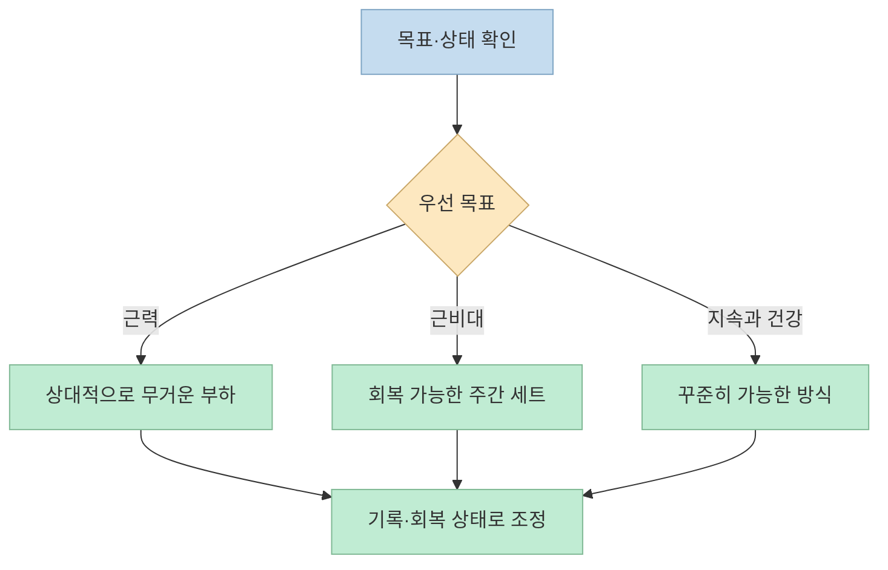
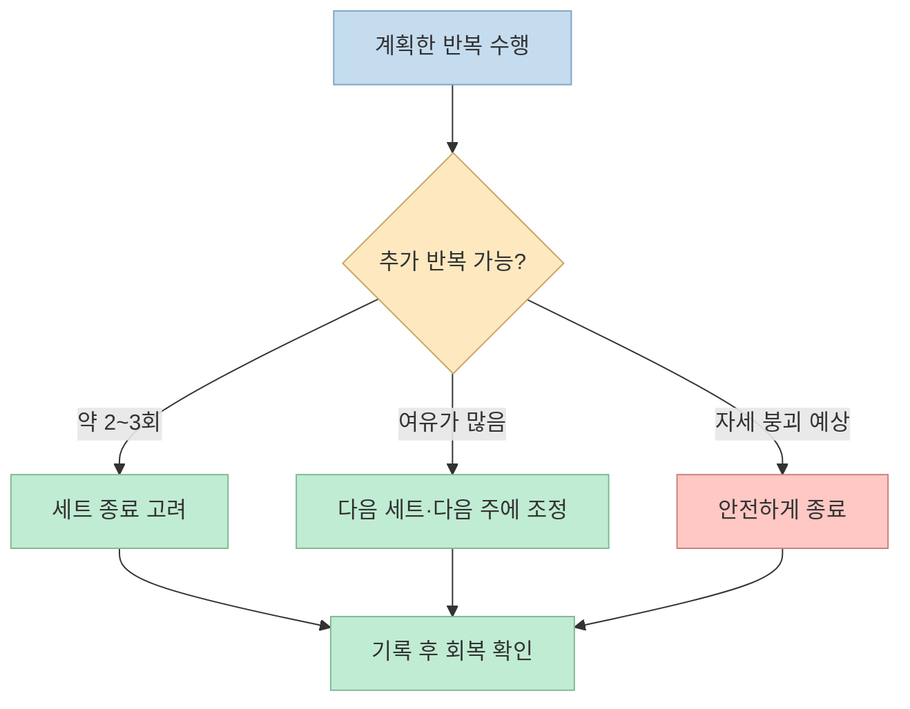
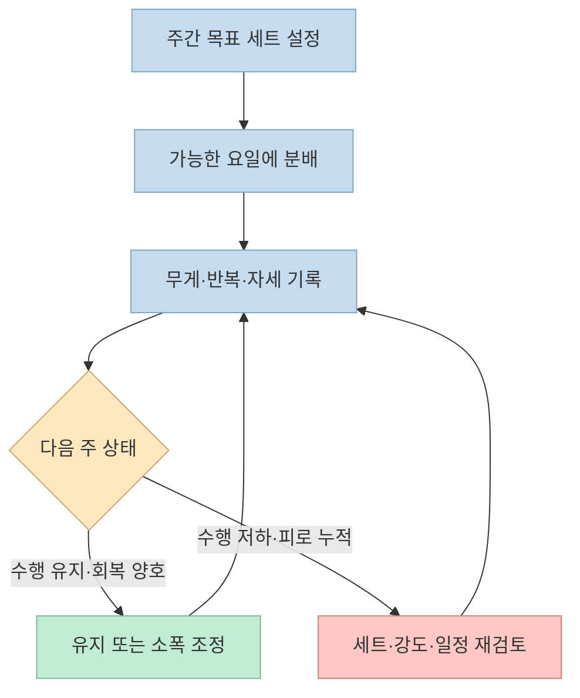
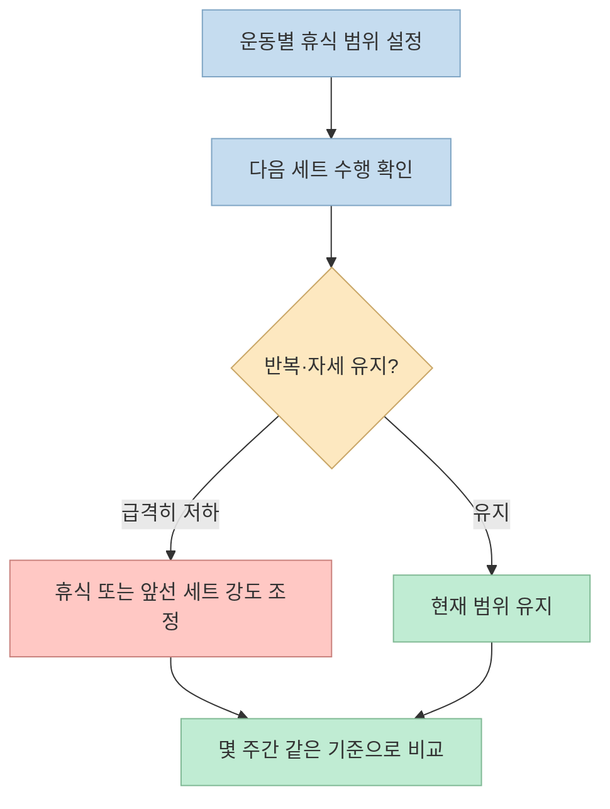

“운동은 덜 빡세게 해야 좋다”, “세트 사이에는 원하는 만큼 쉬어도 된다.” [영상](https://youtu.be/y7vi8BJlHfs?t=75)은 2026년 미국스포츠의학회(ACSM) 근력운동 권고안을 이런 문장으로 소개한다. 방향은 흥미롭지만, **실패 지점까지 몰아붙일 필요가 없다는 것** 과 **아무렇게나 운동해도 결과가 같다는 것** 은 다르다. 영상의 조언을 원문 연구와 나란히 놓고, 실제 훈련에 적용할 수 있는 범위와 주의할 점을 살펴본다.

<!--more-->

## Sources

- [원본 영상: 모든 헬스인을 속인 17년짜리 거짓말](https://youtu.be/y7vi8BJlHfs) — 어썸블리스 AwesomeBLISS. 본문의 영상 내용은 한국어 자동 생성 자막을 기준으로 확인했으며, 주요 주장마다 해당 시점으로 연결했다.
- [ACSM 2026 공식 포지션 스탠드: Resistance Training Prescription for Muscle Function, Hypertrophy, and Physical Performance in Healthy Adults](https://pubmed.ncbi.nlm.nih.gov/41843416/) — 2009년 지침을 갱신한 137개 체계적 문헌고찰의 개요 연구. 원문 전문은 [PubMed Central](https://pmc.ncbi.nlm.nih.gov/articles/PMC12965823/)에서 볼 수 있다.
- [ACSM 발표 설명](https://acsm.org/science-spotlight-acsm-releases-new-position-stand-on-resistance-training/) · [ACSM 핵심 요약 인포그래픽](https://www.acsm.org/wp-content/uploads/2026/03/Resistance-Training-Position-Stand-infographic.pdf)

## 무엇이 바뀌었나: 하나의 정답보다 목표에 맞는 처방

영상은 2009년의 “근비대는 8~12회, 휴식은 1~2분” 같은 규칙을 떠올리며, 2026년에는 운동 처방을 더 유연하게 보게 됐다고 설명한다. 이어서 **운동 목표·숙련도·환경을 먼저 정해야** 적절한 방법을 고를 수 있다고 강조한다. [영상 00:53](https://youtu.be/y7vi8BJlHfs?t=53) · [영상 04:36](https://youtu.be/y7vi8BJlHfs?t=276)

공식 논문은 건강한 성인의 근력운동을 다룬 **137개 체계적 문헌고찰, 3만 명 이상**의 자료를 종합했다. 운동을 전혀 하지 않는 것보다 저항운동을 하는 편이 근력·근육 크기·파워와 여러 신체 기능 지표를 개선했다. 다만 이는 “모든 세부 방법이 동등하다”는 뜻이 아니다. 연구에서는 **근력** 에 무거운 부하(1회 최대 중량의 80% 이상), 충분한 동작 범위, 운동 초반 배치, 주 2회 이상 등이 유리했고, **근비대** 에는 더 많은 주간 세트 수(근육군당 약 10세트 이상)가 유리했다. 이는 건강한 성인에 관한 평균적 결과이지, 개인별 최적량을 판정해 주는 공식은 아니다. [ACSM 논문 초록](https://pubmed.ncbi.nlm.nih.gov/41843416/) · [ACSM 요약](https://www.acsm.org/wp-content/uploads/2026/03/Resistance-Training-Position-Stand-infographic.pdf)

## 실패 지점까지 해야 할까: “덜 힘들게”의 정확한 뜻

영상은 매 세트를 더 이상 반복할 수 없을 때까지 수행하는 것과 그 직전에 멈추는 것의 효과가 비슷하다면, 후자가 일상 피로와 심리적 부담 면에서 낫다고 주장한다. 뒤에서는 **RIR**(repetitions in reserve, 세트를 끝냈을 때 더 할 수 있었을 것으로 추정하는 반복 횟수)을 소개한다. 0 RIR은 추가 반복이 불가능한 상태, 2 RIR은 두 번쯤 더 할 수 있을 것 같은 상태다. 영상은 대체로 1~2 RIR을 실용적 목표로 제시한다. [영상 01:34](https://youtu.be/y7vi8BJlHfs?t=94) · [영상 23:10](https://youtu.be/y7vi8BJlHfs?t=1390) · [영상 23:25](https://youtu.be/y7vi8BJlHfs?t=1405)

원문 논문에서 확인되는 더 정확한 결론은 **일시적 근육 실패까지 가는 훈련이 근력·근비대·파워 향상을 일관되게 더 높이지 않았으므로, 실패까지 가는 것이 필수는 아니다**는 것이다. 논문은 충분한 노력 수준의 한 예로 **2~3 RIR 정도의 실패 직전 훈련**을 제안한다. 따라서 “무조건 낮은 강도가 더 효과적”이 아니라, **적절히 노력하되 매번 완전 실패를 목표로 삼을 이유는 약하다**고 읽어야 한다. 특히 고령자 등 일부 집단에는 실패 지점까지 밀어붙이는 과정에서 자세 붕괴와 위험을 고려해야 한다고 논문은 덧붙인다. [ACSM 논문 전문](https://pmc.ncbi.nlm.nih.gov/articles/PMC12965823/)

영상은 한쪽 다리는 실패까지, 다른 다리는 1~3 RIR로 운동시킨 8주 연구를 소개한다. 다만 한 연구의 비유의적 차이만으로 **모든 사람·운동·기간에서 효과가 완전히 동일하다**고 단정할 수는 없다. 영상이 말하는 “RIR 2는 쉽다는 뜻이 아니다”라는 주의는 유효하다. 자세가 무너지기 직전인지 살피고, 반복 속도가 느려지는 등 자신의 기준을 일관되게 기록하는 편이 숫자 하나를 맹신하는 것보다 낫다. [영상 27:44](https://youtu.be/y7vi8BJlHfs?t=1664) · [영상 28:15](https://youtu.be/y7vi8BJlHfs?t=1695) · [영상 29:58](https://youtu.be/y7vi8BJlHfs?t=1798)

## 운동량과 빈도: “많을수록 좋다”에는 상한이 있다

영상은 운동량을 늘릴 때 **운동 기록의 변화와 일상 피로**를 함께 보라고 한다. 같은 운동의 무게·반복 횟수·수행 질이 여러 주에 걸쳐 떨어지거나, 평소와 같은 수면 후에도 낮에 피로가 심해졌다면 운동량이 회복 능력을 넘었는지 점검하라는 것이다. 출연진은 숙련도와 자세에 따라 적정 세트 수가 달라질 수 있다며 예시로 사람마다 주간 하체 10세트 또는 16세트가 맞을 수 있다고 말한다. 이는 **개인 사례와 코치의 경험적 해석**이지 ACSM이 각 사람에게 지정한 세트 수가 아니다. [영상 07:05](https://youtu.be/y7vi8BJlHfs?t=425) · [영상 09:13](https://youtu.be/y7vi8BJlHfs?t=553)

공식 논문은 근비대에 **근육군당 주간 약 10세트 이상**이라는 방향을 제시하지만, “누구나 10~20세트로 끝내야 한다”거나 “운동량은 끝없이 많을수록 좋다”고 말하지 않는다. 일정 운동량을 넘어서면 추가 효과가 줄거나 피로 부담이 커질 수 있으므로, 시작량과 증량 속도는 개인의 훈련 이력·수행 능력·회복에 맞춰야 한다. 영상의 10~20세트는 [출연진이 제안한 실무적 범위](https://youtu.be/y7vi8BJlHfs?t=570)로 구분해 읽는 편이 정확하다. [ACSM 논문 초록](https://pubmed.ncbi.nlm.nih.gov/41843416/)

영상은 동일한 주간 운동량을 한 번에 몰아서 할지 여러 날로 나눌지도 논의한다. 출연진은 초보자는 한 번에 집중하는 편이, 숙련자는 소량씩 나누는 편이 낫다고 **자신의 경험을 바탕으로** 설명한다. 반면 ACSM 종합 결과는 **총 운동량을 같게 맞춘 근비대 비교에서는 빈도 차이가 일관된 영향을 보이지 않았다**는 것이다. 근력에는 주 2회 이상이 유리한 결과가 제시된다. 따라서 근비대 목적이라면 먼저 감당 가능한 주간 운동량을 정하고, 일정·회복·세트의 질에 따라 나누되 “초보자는 반드시 몰아서 해야 한다”고 일반화하지 않는 것이 좋다. [영상 10:12](https://youtu.be/y7vi8BJlHfs?t=612) · [영상 11:37](https://youtu.be/y7vi8BJlHfs?t=697) · [ACSM 논문](https://pmc.ncbi.nlm.nih.gov/articles/PMC12965823/)

## 반복 수, 자세, 부위별 반응: 영상의 경험담과 연구를 분리하기

영상은 사람과 부위마다 고중량·저반복 또는 저중량·고반복에 대한 반응이 다르다고 이야기한다. 근섬유 비율이나 새로운 자극, 동작 숙련도를 그 이유로 추정하고, 자세가 좋아지면 이전보다 적은 세트나 부하로도 목표 근육을 잘 사용할 수 있다는 경험을 공유한다. 이는 **영상 출연진의 관찰과 가설**이다. 해당 개인의 근섬유 비율을 실제로 측정한 결과나, 특정 부위는 반드시 특정 반복 수가 최적이라는 임상적 판정으로 받아들이면 안 된다. [영상 12:55](https://youtu.be/y7vi8BJlHfs?t=775) · [영상 14:02](https://youtu.be/y7vi8BJlHfs?t=842) · [영상 16:15](https://youtu.be/y7vi8BJlHfs?t=975)

ACSM 종합 결과에서는 **근비대에 사용한 부하의 차이가 일관된 우열을 보이지 않았고**, 근력에는 상대적으로 높은 부하가 유리했다. 운동 성과를 비교할 때는 무게나 반복 횟수뿐 아니라 동작 범위와 자세가 유지되는지 함께 살펴야 한다. 한 번의 “자극감”만으로 운동이 효과적이었는지 판정하기보다, 같은 조건에서 꾸준히 수행하고 기록의 장기 추세를 보자는 뜻이다. [ACSM 논문 초록](https://pubmed.ncbi.nlm.nih.gov/41843416/)

## 세트 사이 휴식: “영향이 일관되지 않다”와 “무제한 쉬어도 된다”는 다르다

영상은 팔·복근 등에는 약 1~1분 30초, 가슴·광배에는 약 2분, 스쿼트·데드리프트에는 약 2분 30초~3분이라는 **출연진 개인의 운영 기준**을 소개한다. 이어서 ACSM 결과를 “휴식 시간은 중요하지 않다”로 풀어 설명하면서도, 다음 세트의 수행량이 크게 떨어지면 쉬는 시간을 조정해야 한다고 덧붙인다. [영상 19:20](https://youtu.be/y7vi8BJlHfs?t=1160) · [영상 20:57](https://youtu.be/y7vi8BJlHfs?t=1257) · [영상 21:47](https://youtu.be/y7vi8BJlHfs?t=1307)

공식 논문이 말하는 것은 검토한 연구들에서 **세트 간 휴식 길이가 근력·근비대 결과에 일관된 영향을 주지 않았다**는 것이다. 이는 모든 휴식 시간이 똑같이 좋다거나, 10~20분씩 쉬어도 훈련의 시간·흐름·수행에 아무 손해가 없다는 보증이 아니다. 반대로 짧게 쉬느라 목표 반복 수나 자세가 무너지면 세트의 질을 점검해야 한다. 영상의 예시처럼 처음에는 일정한 범위를 정해 두고, 같은 운동·무게에서 다음 세트 수행이 어떻게 변하는지 보며 조정할 수 있다. [ACSM 논문](https://pmc.ncbi.nlm.nih.gov/articles/PMC12965823/) · [영상 21:54](https://youtu.be/y7vi8BJlHfs?t=1314)

## 실전 적용 포인트: 쉬운 계획에서 시작해 기록으로 조정하기

영상 말미는 “처음부터 무리한 프로그램을 짜지 말고, 해낼 수 있다고 느껴지는 계획으로 시작하라”고 권한다. 레그 익스텐션·랫풀다운 같은 기구에서도 무게 경쟁보다 동작의 목표와 자세를 점검하고, 운동을 단기 성과보다 평생 지속할 습관으로 보자는 이야기다. 다만 특정 근육에 자극이 잘 느껴지지 않는다는 이유만으로 신체 이상을 스스로 진단해서는 안 된다. 통증·저림·지속적인 기능 제한이 있다면 운동 강도를 낮추고 전문가에게 평가받는 편이 안전하다. [영상 32:13](https://youtu.be/y7vi8BJlHfs?t=1933) · [영상 33:31](https://youtu.be/y7vi8BJlHfs?t=2011) · [영상 35:53](https://youtu.be/y7vi8BJlHfs?t=2153)

실행 순서는 단순하다.

1. **목표를 하나 정한다.** 근력 향상인지, 근비대인지, 규칙적인 건강 관리인지에 따라 우선 지표를 고른다. [ACSM 요약](https://www.acsm.org/wp-content/uploads/2026/03/Resistance-Training-Position-Stand-infographic.pdf)
2. **지속 가능한 빈도와 운동량으로 시작한다.** 주 2회 이상 주요 근육군을 다루는 방향을 기본 틀로 삼고, 무리한 세트 증가는 피한다. [ACSM 논문](https://pmc.ncbi.nlm.nih.gov/articles/PMC12965823/) · [영상 32:33](https://youtu.be/y7vi8BJlHfs?t=1953)
3. **각 세트의 무게·반복·RIR 추정치·휴식·자세를 기록한다.** RIR은 정확한 기계 측정치가 아니라 자기 추정이므로, 같은 기준으로 비교하는 데 의미가 있다. [영상 26:30](https://youtu.be/y7vi8BJlHfs?t=1590)
4. **몇 주간의 수행과 회복을 함께 본다.** 세트 수를 늘렸는데 운동 질과 일상 컨디션이 떨어진다면, 더 늘리는 대신 현재 계획을 조정한다. [영상 07:27](https://youtu.be/y7vi8BJlHfs?t=447)

## 핵심 요약

- 2026년 ACSM 권고안은 2009년 문서를 갱신한 **근력운동 연구 종합**이다. 운동을 지속하는 것이 출발점이며, 목표에 따라 부하와 운동량을 조정한다. [ACSM 발표](https://acsm.org/science-spotlight-acsm-releases-new-position-stand-on-resistance-training/)
- **매 세트를 실패까지 할 필요는 없다.** 논문은 충분한 노력의 예로 실패 직전 약 2~3 RIR을 제안한다. 영상의 1~2 RIR은 조금 더 구체적인 코칭 기준이다. [ACSM 논문](https://pmc.ncbi.nlm.nih.gov/articles/PMC12965823/) · [영상 23:10](https://youtu.be/y7vi8BJlHfs?t=1390)
- **근비대에는 주간 운동량이 중요하다.** 다만 10~20세트 같은 단일 숫자를 전원에게 강제하거나, 회복을 무시하고 계속 늘리는 것은 원문 취지가 아니다. [ACSM 논문 초록](https://pubmed.ncbi.nlm.nih.gov/41843416/) · [영상 09:30](https://youtu.be/y7vi8BJlHfs?t=570)
- **휴식과 빈도는 맥락 속에서 조정한다.** 연구에서 일관된 우열이 없다는 말은 시간·자세·수행량을 무시해도 된다는 뜻이 아니다. [ACSM 논문](https://pmc.ncbi.nlm.nih.gov/articles/PMC12965823/)

## 결론

이 영상의 가장 실용적인 메시지는 “대충 해도 된다”가 아니라 **실패 지점·세트 수·휴식 시간을 고정된 신앙처럼 따르지 말고, 목표와 회복에 맞춰 조정하자**는 것이다. 시작하기 쉬운 계획을 꾸준히 수행하고, 기록과 컨디션을 보며 조금씩 수정하는 편이 17년 된 규칙을 다른 절대 규칙으로 바꾸는 것보다 낫다. [영상 36:00](https://youtu.be/y7vi8BJlHfs?t=2160) · [ACSM 논문](https://pubmed.ncbi.nlm.nih.gov/41843416/)
