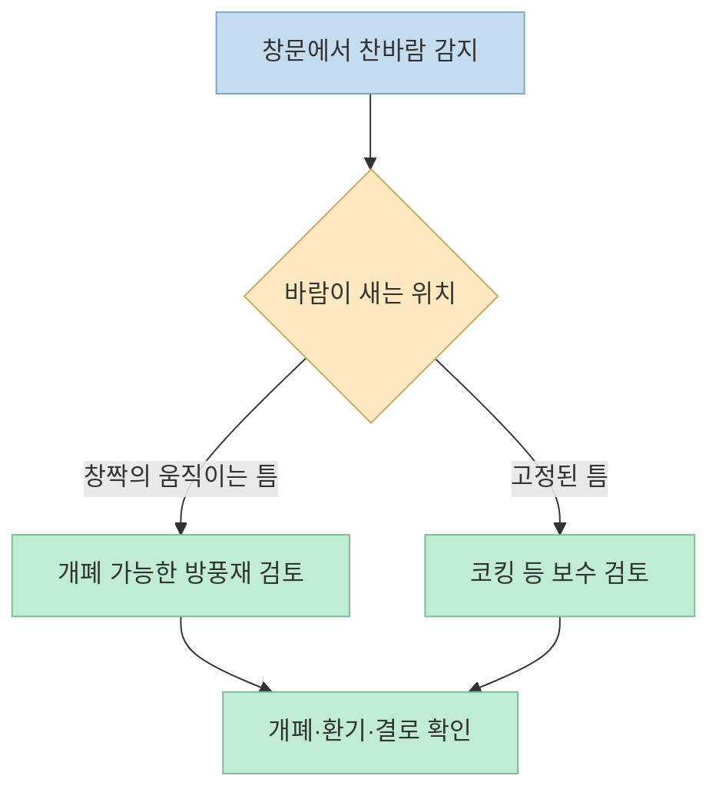
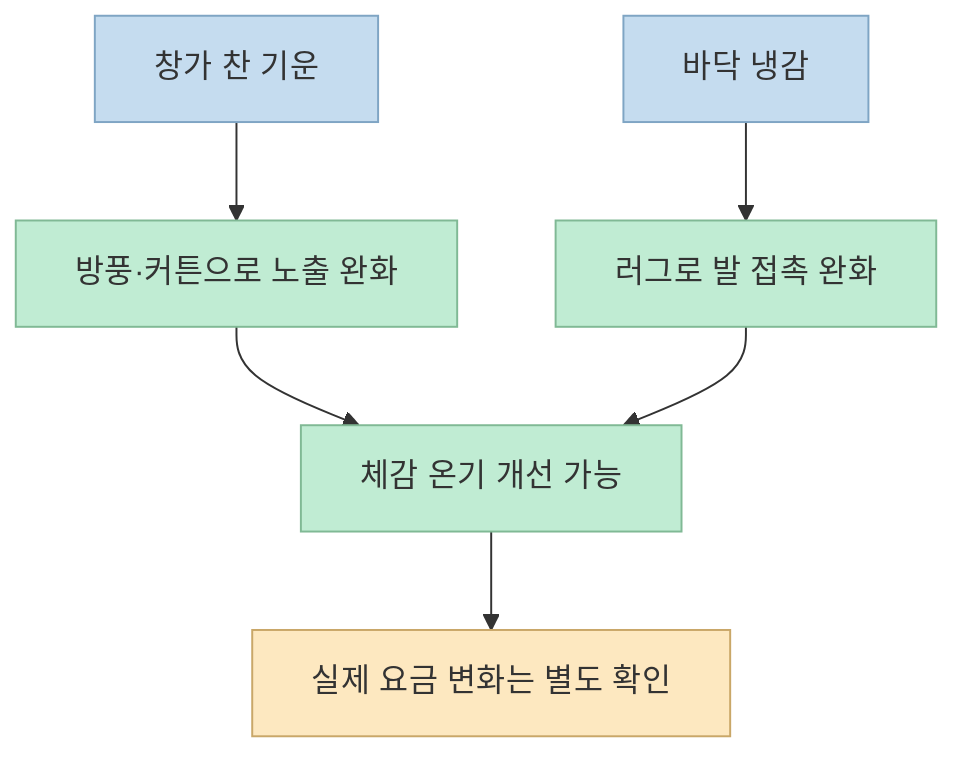
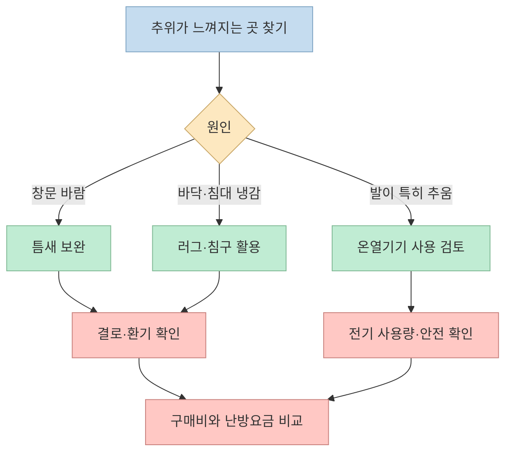

“난방비 0원 도전”이라는 쇼츠는 창문 틈새 바람을 막고, 커튼과 러그를 깔고, 따뜻한 침구와 잠옷을 쓰는 순서로 방한법을 소개한다. 마지막에는 전기 발찜질기도 등장한다. 실내에서 **덜 춥게 느끼는 방법** 과 **난방요금이 실제로 0원이 되는 방법** 은 다르다. 일곱 가지 제안을 작동 원리와 비용, 결로·전기 안전까지 나눠 살펴보자. [영상 00:00](https://youtu.be/ubF3E2UYJAo?t=0) · [영상 01:01](https://youtu.be/ubF3E2UYJAo?t=61)

<!--more-->

## Sources

- [원본 쇼츠: 난방비 0원 도전합니다](https://youtube.com/shorts/ubF3E2UYJAo?si=dB-RJVmXbbitHjcM) — 원룸만들기. 영상의 일곱 제안은 한국어 자동 생성 자막을 기준으로 확인했다.
- [미국 에너지부: 임차인을 위한 에너지 절약 팁](https://www.energy.gov/articles/5-tips-energy-saving-renters) · [겨울철 창문·커튼 활용](https://www.energy.gov/indianenergy/articles/six-simple-steps-save-energy-and-money-winter)
- [미국 환경보호청(EPA): 가정 내 습기 관리](https://www.epa.gov/mold/what-are-main-ways-control-moisture-your-home) · [곰팡이·결로 대응](https://www.epa.gov/mold/brief-guide-mold-moisture-and-your-home)
- [영국 런던소방청: 전기담요 안전 수칙](https://www.london-fire.gov.uk/safety/the-home/electrical-items/electric-blankets/) · [미국 소비자제품안전위원회: 침실 온열용품 주의](https://www.cpsc.gov/s3fs-public/701.pdf)

## 1. 창틀 방풍 비닐: 먼저 틈새 바람을 확인한다

쇼츠의 첫 번째 방법은 **창틀에 자석 테이프를 붙이고 방풍용 비닐을 설치하는 것** 이다. 영상은 찬바람을 막으면서도 자석으로 열고 닫을 수 있다고 설명한다. [영상 00:02](https://youtu.be/ubF3E2UYJAo?t=2) · [영상 00:07](https://youtu.be/ubF3E2UYJAo?t=7) 미국 에너지부도 창문·문 주변 틈새의 공기 누출을 막는 방풍재와 코킹을 저비용 개선책으로 제시한다. 다만 **영상의 자석 비닐 제품 자체** 가 모든 창틀에서 동일하게 밀착한다거나 난방비를 얼마나 줄이는지는 확인할 자료가 없다. [미국 에너지부: 임차인 절약 팁](https://www.energy.gov/articles/5-tips-energy-saving-renters)

시공 전에는 바람이 **움직이는 창짝의 틈** 에서 들어오는지, **창틀과 벽 사이의 고정된 틈** 에서 들어오는지 구분해야 한다. 미국 에너지부의 설명처럼 움직이는 부분에는 방풍재, 고정된 균열에는 코킹 등 용도가 다르다. 비닐을 붙인 뒤에도 창문 개폐와 필요한 환기가 가능한지 확인한다. [미국 에너지부: 기밀 보강 방법](https://www.energy.gov/cmei/buildings/articles/energy-efficient-home-improvement-credit-insulation-and-air-sealing)

## 2. 패딩 커튼과 러그: 열손실 완화와 체감 보온은 구분한다

두 번째 방법은 방풍 비닐 앞에 **두꺼운 패딩 커튼** 을 달아 찬 창문의 영향을 줄이는 것이다. 쇼츠는 생활 방수 소재라 결로가 심한 집에도 좋다고 말한다. [영상 00:14](https://youtu.be/ubF3E2UYJAo?t=14) 커튼은 창가 냉기를 줄이는 데 도움이 될 수 있다. 미국 에너지부는 겨울에 낮에는 햇볕이 드는 창의 커튼을 열어 자연열을 들이고, 밤에는 닫아 냉기를 줄이는 방식을 권한다. 다만 **방수 커튼이 결로를 해결한다는 근거는 아니다.** [미국 에너지부: 겨울철 절약 팁](https://www.energy.gov/indianenergy/articles/six-simple-steps-save-energy-and-money-winter)

세 번째 방법인 **러그** 는 차가운 바닥과 발 사이에 층을 만들어 발의 체감 냉기를 줄이는 선택이다. 쇼츠는 완충에 따른 층간 소음 효과도 언급하지만, 해당 러그의 차음 성능이나 난방비 절감액을 측정한 자료는 제시하지 않는다. 러그는 보일러나 전열기처럼 방에 열을 공급하지 않으므로, **발이 덜 시리다**는 경험과 **집 전체 난방비가 절감된다**는 주장을 분리해야 한다. [영상 00:23](https://youtu.be/ubF3E2UYJAo?t=23) 이 설명은 영상의 제품 체험과 열전달 원리에서 내린 해석이다.

## 3. 극세사 토퍼·잠옷·이불: 침대에서의 온기를 높인다

네 번째부터 여섯 번째까지는 침대에 **극세사 토퍼** 를 깔고, **극세사 잠옷** 을 입고, 몸에 감기는 **두꺼운 이불** 을 덮는 방법이다. 영상은 부드럽고 따뜻하다는 사용 경험을 전하지만, 소재별 보온 성능을 비교한 시험이나 실제 난방요금 수치는 제공하지 않는다. [영상 00:32](https://youtu.be/ubF3E2UYJAo?t=32) · [영상 00:42](https://youtu.be/ubF3E2UYJAo?t=42) · [영상 00:52](https://youtu.be/ubF3E2UYJAo?t=52)

이 세 가지는 주로 **몸 가까이에 따뜻한 공기층을 유지하고 피부의 차가운 표면 접촉을 줄이는 방식** 으로 이해할 수 있다. 따라서 침대에 있을 때의 쾌적함에는 도움을 줄 수 있지만, 실내 공기를 가열하지는 않는다. 이미 가진 침구를 조합해 볼 수 있으나 새 제품을 산다면 구매비도 함께 계산해야 한다. 젖은 침구나 러그는 충분히 말리고, 창가에 물방울이 맺히면 가구·섬유 뒤에 습기가 갇히지 않는지 확인하는 것이 좋다. EPA는 결로가 보이면 젖은 표면을 말리고 습기 원인을 줄이라고 안내한다. [EPA: 곰팡이·습기 안내](https://www.epa.gov/mold/brief-guide-mold-moisture-and-your-home)

## 4. 전기 발찜질기: 마지막 방법은 ‘0원’이 아니다

일곱 번째는 영상에서 **전기 발찜질기** 로 소개되는 발 보온 제품이다. 출연자는 전기요금이 적게 든다는 취지로 말하지만, 끝부분에서도 전기를 쓴다는 점을 인정한다. 자막만으로는 제품의 정확한 모델·소비전력·자동 차단 기능을 확인할 수 없다. [영상 01:01](https://youtu.be/ubF3E2UYJAo?t=61) · [영상 01:05](https://youtu.be/ubF3E2UYJAo?t=65)

전기 사용량은 대략 **소비전력(W) × 사용시간(h) ÷ 1,000 = 사용량(kWh)** 로 계산한다. 제품 표시 소비전력과 실제 사용시간이 없으면 요금을 단정할 수 없고, 구매비도 별개다. 이 계산은 전기 사용량을 가늠하는 식이지 특정 제품의 실측 소비량은 아니다. 전기 온열제품을 쓸 때는 **제품 설명서와 안전 표시를 먼저 확인** 하고, 전선 손상·과열·젖음이 있으면 사용을 중지한다. 침구용 온열기기를 다룬 [런던소방청](https://www.london-fire.gov.uk/safety/the-home/electrical-items/electric-blankets/)과 [미국 소비자제품안전위원회](https://www.cpsc.gov/s3fs-public/701.pdf)의 안내 역시 손상 점검과 취침 중 사용 주의를 강조한다. 발찜질기의 사용 가능 조건은 해당 제품 설명서를 우선한다.

## 실전 적용 포인트: 결로와 비용을 함께 기록한다

쇼츠의 장점을 살리려면 구매 목록부터 만들기보다 **집에서 실제로 추운 위치를 찾는 것** 이 먼저다. 창문 틈의 바람인지, 창가의 냉기인지, 맨발로 밟는 바닥인지, 침대에서의 추위인지에 따라 조치가 다르다. 비용도 제품 구매비·전기 사용량·난방요금으로 분리한다. [영상 00:02](https://youtu.be/ubF3E2UYJAo?t=2) · [영상 00:24](https://youtu.be/ubF3E2UYJAo?t=24) · [영상 01:01](https://youtu.be/ubF3E2UYJAo?t=61)

1. **창문 틈을 점검한다.** 바람이 새는 곳만 보완하고, 설치 후에도 열고 닫을 수 있는지 확인한다. [미국 에너지부](https://www.energy.gov/articles/5-tips-energy-saving-renters)
2. **커튼·러그·침구는 체감 개선용으로 선택한다.** 이미 있는 물건을 먼저 활용하고, 새로 살 경우 가격을 포함해 판단한다. [영상 00:16](https://youtu.be/ubF3E2UYJAo?t=16) · [영상 00:33](https://youtu.be/ubF3E2UYJAo?t=33)
3. **결로를 가리지 말고 관리한다.** 비닐이나 커튼 뒤에 물기가 쌓이는지 확인하고, 젖은 곳은 말리며 필요할 때 환기·제습한다. EPA는 습기와 곰팡이 관리를 위해 이런 조치를 권한다. [EPA: 실내 습기 관리](https://www.epa.gov/mold/what-are-main-ways-control-moisture-your-home)
4. **발찜질기는 소비전력과 사용시간을 확인한다.** 온열 제품을 켠 채 잠드는 등 제품 설명서에서 금지한 사용 방식은 피한다. [영상 01:01](https://youtu.be/ubF3E2UYJAo?t=61) · [런던소방청](https://www.london-fire.gov.uk/safety/the-home/electrical-items/electric-blankets/)

## 핵심 요약

- **창틀 방풍과 커튼** 은 틈새 바람·창가 냉기를 줄이는 데 도움이 될 수 있다. 다만 제품별 절감률은 영상에서 검증되지 않았다. [영상 00:07](https://youtu.be/ubF3E2UYJAo?t=7) · [미국 에너지부](https://www.energy.gov/articles/5-tips-energy-saving-renters)
- **러그·토퍼·잠옷·이불** 은 주로 몸의 체감 온기를 높이는 방법이지, 방 전체를 데우는 수단은 아니다. [영상 00:24](https://youtu.be/ubF3E2UYJAo?t=24) · [영상 00:52](https://youtu.be/ubF3E2UYJAo?t=52)
- **방수 커튼은 결로 해결책이 아니다.** 물기가 생기면 말리고 습기·환기를 관리해야 한다. [EPA](https://www.epa.gov/mold/brief-guide-mold-moisture-and-your-home)
- **전기 발찜질기에는 구매비와 전기 사용량이 든다.** 영상 제목의 “0원”은 검증된 요금 결과로 볼 수 없다. [영상 01:05](https://youtu.be/ubF3E2UYJAo?t=65)

## 결론

이 쇼츠의 일곱 가지는 겨울 원룸에서 **어디가 추운지 찾아 국소적으로 보완하는 아이디어** 로는 쓸 만하다. 다만 방풍재·침구·전기제품의 효과와 비용은 집과 사용 방식에 따라 달라진다. 결로와 안전을 확인하면서, 기존 난방요금과 실제 지출을 비교해야 “따뜻해졌다”와 “돈을 아꼈다”를 구분할 수 있다.
