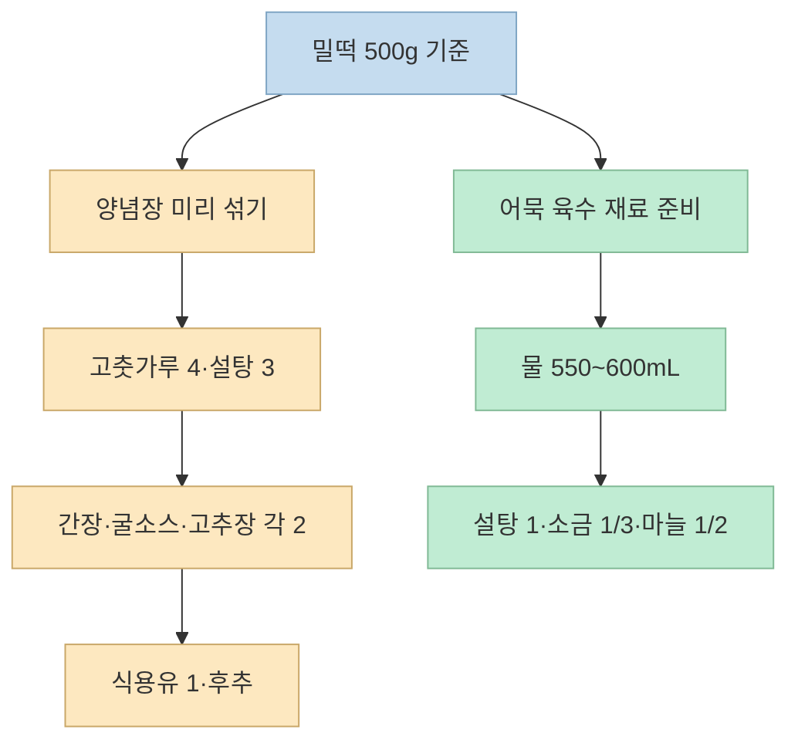
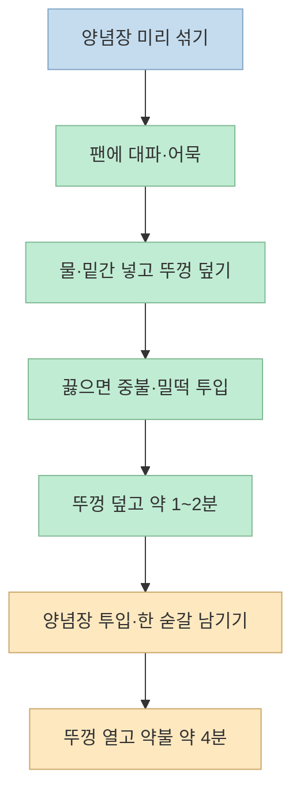

“고춧가루 네 숟갈, 설탕 세 숟갈, 간장·굴소스·고추장은 두 숟갈씩.” 짧은 [쇼츠](https://youtu.be/llNxdthfo98?t=6)에서 가장 기억하기 쉬운 대목이다. 하지만 떡볶이 맛은 **양념 비율뿐 아니라 어묵을 먼저 끓이고, 떡을 익힌 다음 양념을 넣는 순서**에도 달려 있다. 쇼츠의 자동 자막에서 흐릿한 계량은 KBS 《신상출시 편스토랑》의 [원본 레시피 영상](https://www.youtube.com/watch?v=xtW8mjglyfY)과 대조했다.

<!--more-->

## Sources

- [입력 쇼츠: 초간단 쉽게 만드는 류수영 평생 떡볶이](https://youtube.com/shorts/llNxdthfo98?si=kEHz0PcHpZnavW6b) — 라면남자. 한국어 자동 생성 자막을 확인했다.
- [KBS 《신상출시 편스토랑》: 류수영 평생 떡볶이 공식 레시피 영상](https://www.youtube.com/watch?v=xtW8mjglyfY) — 2023년 7월 21일 방송 장면. 영상 설명란에 양념과 조리 순서가 명시돼 있다.

## 재료: 밀떡 500g을 기준으로 계량하기

쇼츠에는 양념 숫자가 빠르게 지나가고 떡·어묵의 양은 자세히 나오지 않는다. KBS 원본은 **밀떡 500g 기준**이라고 밝히며, 대파 약 1대와 어묵을 함께 준비한다. 원본 화면에서는 포장된 어묵 약 4~5장을 취향에 따라 사용한다고 설명한다. 물은 라면 한 개를 끓일 때와 비슷한 **550~600mL**다. [쇼츠 00:21](https://youtu.be/llNxdthfo98?t=21) · [KBS 03:00](https://youtu.be/xtW8mjglyfY?t=180) · [KBS 01:15](https://youtu.be/xtW8mjglyfY?t=75) · [KBS 05:42](https://youtu.be/xtW8mjglyfY?t=342)

준비할 재료를 두 묶음으로 나누면 헷갈리지 않는다.

- **주재료:** 밀떡 500g, 대파 약 1대, 어묵 약 4~5장, 물 550~600mL. 어묵 장수는 포장 크기와 취향에 따라 달라질 수 있다. [KBS 01:00](https://youtu.be/xtW8mjglyfY?t=60) · [KBS 05:42](https://youtu.be/xtW8mjglyfY?t=342)
- **미리 섞어 둘 양념장:** 고춧가루 4큰술, 설탕 3큰술, 간장 2큰술, 굴소스 2큰술, 고추장 2큰술, 식용유 1큰술, 후추 약 20바퀴. KBS 영상 설명란의 계량이며, ‘4·3·2·2·2’는 앞의 다섯 양념을 기억하는 방식이다. [쇼츠 00:06](https://youtu.be/llNxdthfo98?t=6) · [KBS 03:00](https://youtu.be/xtW8mjglyfY?t=180) · [KBS 04:30](https://youtu.be/xtW8mjglyfY?t=270)
- **어묵 육수에 따로 넣을 밑간:** 설탕 1큰술, 소금 1/3큰술, 다진 마늘 1/2큰술. **설탕은 양념장 3큰술과 육수 1큰술로 나뉘므로 전체 사용량은 4큰술**이다. 쇼츠만 보고 밑간용 설탕을 빠뜨리기 쉽다. [쇼츠 00:27](https://youtu.be/llNxdthfo98?t=27) · [KBS 05:45](https://youtu.be/xtW8mjglyfY?t=345)

## 조리 순서: 어묵 육수부터, 양념은 나중에

쇼츠는 “조리 순서만 중요하다”고 강조한 뒤 대파와 어묵을 팬에 깔고 물을 붓는다. KBS 원본의 순서를 따라 하면 **양념을 처음부터 넣지 않는다**는 점이 핵심이다. 출연자는 먼저 어묵을 물에 끓이는 편이 육수를 내기 좋았다고 설명한다. 이는 레시피 개발자의 조리 경험을 설명한 것이지, 모든 떡볶이에 적용되는 필수 과학 법칙이라는 뜻은 아니다. [쇼츠 00:19](https://youtu.be/llNxdthfo98?t=19) · [KBS 06:15](https://youtu.be/xtW8mjglyfY?t=375)

1. **양념장을 먼저 섞는다.** 고춧가루 4, 설탕 3, 간장 2, 굴소스 2, 고추장 2, 식용유 1큰술과 후추를 섞어 둔다. [KBS 03:30](https://youtu.be/xtW8mjglyfY?t=210)
2. **팬에 대파와 어묵을 깐다.** 달군 팬에 대파를 먼저 올리고 어묵을 얹는다. 별도의 식용유를 팬에 붓는 단계는 원본 조리 순서에 없다. 식용유 1큰술은 앞서 만든 **양념장에 들어간다**. [KBS 05:25](https://youtu.be/xtW8mjglyfY?t=325) · [KBS 04:00](https://youtu.be/xtW8mjglyfY?t=240)
3. **물과 밑간을 넣고 끓인다.** 물 550~600mL, 설탕 1큰술, 소금 1/3큰술, 다진 마늘 1/2큰술을 넣는다. 뚜껑을 덮고 끓여 어묵 육수를 낸다. [KBS 05:42](https://youtu.be/xtW8mjglyfY?t=342) · [KBS 06:15](https://youtu.be/xtW8mjglyfY?t=375)
4. **끓어오르면 중불로 낮추고 밀떡을 넣는다.** 다시 뚜껑을 덮어 약 1~2분 익힌다. 원본은 떡이 불면서 색이 달라지는 모습을 다음 단계로 넘어갈 신호로 보여 준다. 팬 크기와 떡의 상태에 따라 시간은 달라질 수 있다. [KBS 06:45](https://youtu.be/xtW8mjglyfY?t=405) · [KBS 07:15](https://youtu.be/xtW8mjglyfY?t=435)
5. **양념장을 넣고 뚜껑을 연 채 약불로 끓인다.** KBS 원본은 양념장을 한꺼번에 모두 넣지 말고 **한 숟갈 정도 남겨** 마지막 간을 보라고 한다. 이후 뚜껑을 열고 약불에서 약 4분 뭉근히 끓인다. [쇼츠 00:40](https://youtu.be/llNxdthfo98?t=40) · [쇼츠 00:44](https://youtu.be/llNxdthfo98?t=44) · [KBS 08:00](https://youtu.be/xtW8mjglyfY?t=480) · [KBS 09:00](https://youtu.be/xtW8mjglyfY?t=540)

## 농도와 간: 남겨 둔 양념으로 마지막에 조절

쇼츠는 마지막에 **약불 4분**을 강조한다. KBS 원본에서도 출연자는 강한 불로 빨리 끓이기보다 뚜껑을 열고 뭉근히 졸여 걸쭉한 상태를 만든다. 이는 영상에서 소개한 **시장 떡볶이 같은 질감**을 목표로 한 조리법이다. 원본은 완성 직전 맛을 보고 더 진한 맛을 원하면 남겨 둔 양념을 추가하거나 조금 더 졸이라고 안내한다. [쇼츠 00:44](https://youtu.be/llNxdthfo98?t=44) · [KBS 08:45](https://youtu.be/xtW8mjglyfY?t=525) · [KBS 09:45](https://youtu.be/xtW8mjglyfY?t=585)

따라서 처음부터 양념을 전부 넣고 마지막에 물로 희석하기보다, **조금 남겨 둔 뒤 맛을 보며 더하는 방식**이 원본에 가깝다. 이미 너무 졸아들었다면 같은 농도가 될 때까지 무조건 4분을 채우기보다는 팬 상태를 보며 불을 조절해야 한다. 뒤 문장은 원본의 고정 계량이 아니라 조리 중 과도한 졸임을 피하기 위한 실용적 해석이다. [KBS 08:00](https://youtu.be/xtW8mjglyfY?t=480) · [KBS 09:45](https://youtu.be/xtW8mjglyfY?t=585)

## 실전 적용 포인트

- **설탕을 두 번 나눠 담는다.** 양념장 3큰술, 육수 밑간 1큰술이다. 쇼츠의 “설탕 세 개”는 양념장만 가리킨다. [쇼츠 00:10](https://youtu.be/llNxdthfo98?t=10) · [KBS 05:45](https://youtu.be/xtW8mjglyfY?t=345)
- **밀떡 500g을 기준으로 시작한다.** 원본의 양념과 물 계량은 이 분량에 맞춰 제시됐다. 떡 양을 크게 바꾸면 같은 양념을 그대로 쓰지 말고 간을 다시 봐야 한다. [KBS 03:00](https://youtu.be/xtW8mjglyfY?t=180)
- **양념보다 어묵 육수가 먼저다.** 대파·어묵과 밑간을 끓인 뒤 떡을 넣고, 그 후에 양념을 더한다. [쇼츠 00:24](https://youtu.be/llNxdthfo98?t=24) · [KBS 06:45](https://youtu.be/xtW8mjglyfY?t=405)
- **마지막에는 뚜껑을 연다.** 약불에서 뭉근히 끓이되, 약 4분이라는 시간뿐 아니라 국물의 농도와 간을 함께 본다. [쇼츠 00:42](https://youtu.be/llNxdthfo98?t=42) · [KBS 09:00](https://youtu.be/xtW8mjglyfY?t=540)

## 핵심 요약

**양념장 비율은 4·3·2·2·2** — 고춧가루 4큰술, 설탕 3큰술, 간장·굴소스·고추장 각 2큰술이다. 여기에 식용유 1큰술과 후추를 넣는다. 물 550~600mL에 대파·어묵을 먼저 끓일 때 **설탕 1큰술, 소금 1/3큰술, 다진 마늘 1/2큰술**을 별도로 넣는다. 밀떡을 익힌 뒤 양념장을 넣고 뚜껑을 열어 약불에서 약 4분 끓인다. [KBS 공식 레시피](https://www.youtube.com/watch?v=xtW8mjglyfY) · [쇼츠 00:06](https://youtu.be/llNxdthfo98?t=6) · [쇼츠 00:44](https://youtu.be/llNxdthfo98?t=44)

## 결론

이 쇼츠의 핵심은 양념 숫자를 외우는 것만이 아니라 **어묵 육수 → 밀떡 → 양념장 → 약불 졸이기**라는 순서를 지키는 데 있다. KBS 원본에서 빠진 분량을 보완하면 처음 만드는 사람도 계량과 투입 시점을 덜 헷갈릴 수 있다.
