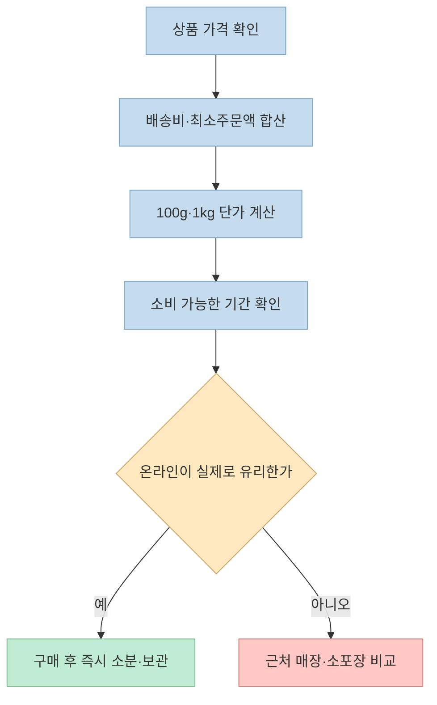
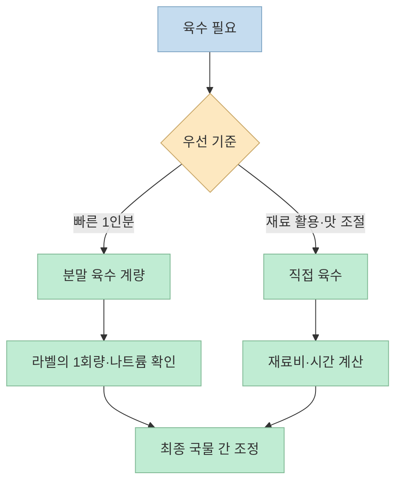
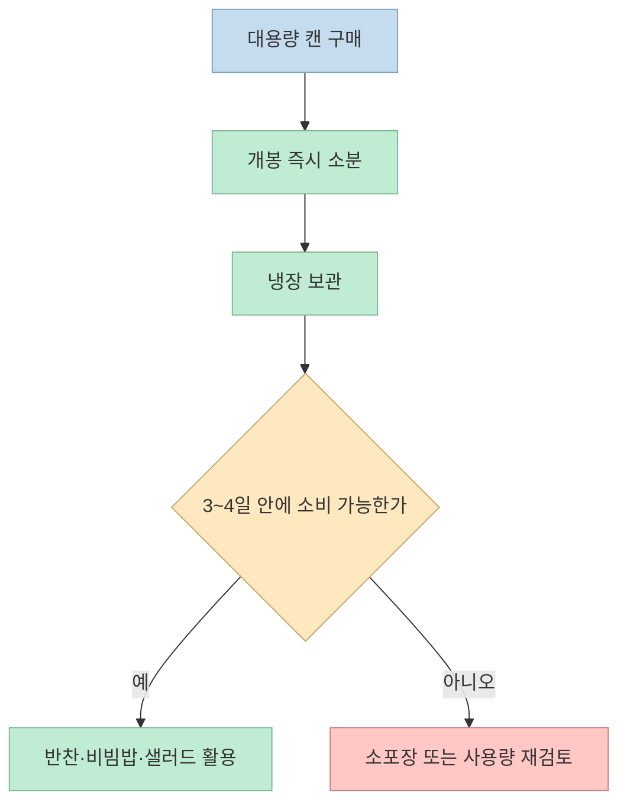
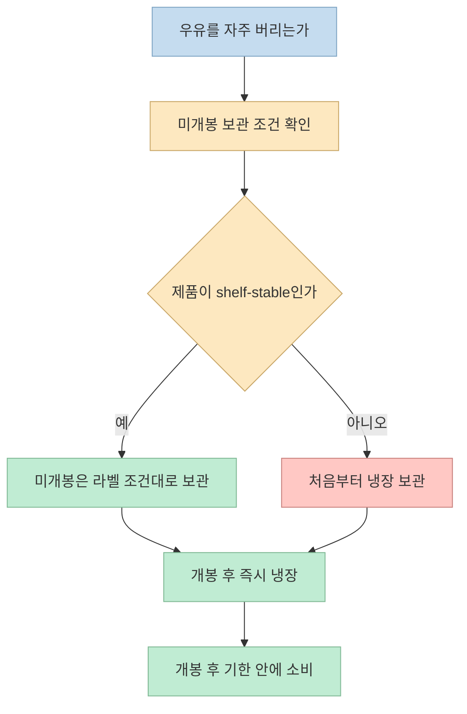

“마트에 가면 호구”라는 강한 표현으로 시작하는 쇼츠는 자취생의 식비를 줄이는 다섯 가지 방법을 소개한다. 채소와 달걀만 마트에서 사고, 고기·육수·참치·대파·우유는 더 오래 보관할 수 있는 형태로 사라는 내용이다. 방향은 이해하기 쉽지만 **싼 단가와 실제 절약액은 다르다.** 한 번에 많이 사서 버리면 오히려 손해이므로 가격, 사용량, 보관 기간을 함께 계산해야 한다. [영상 00:00](https://youtu.be/wLB3E6kSFO4?t=0)

<!--more-->

## Sources

- [원본 쇼츠: 자취 11년차가 알려준 자취꿀팁 5가지](https://youtube.com/shorts/wLB3E6kSFO4?si=aSHa28HbQ6_VhKBh) — 득템. 한국어 자동 생성 자막을 기준으로 확인했다.
- [미국 농무부 FSIS: 개봉한 통조림의 냉장 보관 기간](https://ask.fsis.usda.gov/article/After-you-open-a-can-how-long-can-you-keep-the-food-in-the-refrigerator)
- [미국 농무부 FSIS: 상온 보관 식품의 의미](https://ask.fsis.usda.gov/article/What-does-shelf-stable-mean) · [상업용 통조림 보관 안내](https://ask.fsis.usda.gov/article/How-long-can-you-keep-canned-goods)

## 1. “마트 대신 인터넷”은 품목별로 나눠 판단한다

쇼츠는 마트에서는 채소와 달걀처럼 빨리 상하는 품목만 사고, 나머지는 인터넷이 압도적으로 싸다고 말한다. 특히 브라질산 닭고기나 수입 고기를 검색하고 1kg 단위로 사서 소분 냉동하라고 권한다. [영상 00:05](https://youtu.be/wLB3E6kSFO4?t=5) · [영상 00:11](https://youtu.be/wLB3E6kSFO4?t=11)

그러나 **온라인이 항상 더 싸다는 일반화는 확인되지 않는다.** 판매가에는 배송비, 묶음 최소 주문액, 쿠폰, 냉장·냉동 배송비가 들어간다. 비교할 때는 상품 페이지의 100g 또는 1kg 단가에 배송비를 더하고, 실제로 소비할 수 있는 양까지 계산해야 한다. USDA는 생닭·다진 고기 등은 냉장 보관 가능 기간이 짧으므로 1~2일 안에 조리하거나 냉동하라고 안내한다. 구매 직후 소분 냉동하라는 쇼츠의 방향은 안전한 보관을 전제로 할 때 의미가 있다. [USDA FSIS: 육류 보관 기간](https://ask.fsis.usda.gov/article/How-long-can-you-keep-meat-or-poultry-products-in-the-refrigerator)

고기를 소분할 때는 한 번에 쓸 양만큼 얇게 나누고 포장 날짜를 적는다. 냉동은 부패를 무한히 없애는 방법이 아니라 품질 저하를 늦추는 방법이다. 해동한 고기를 다시 얼릴 때는 조리 여부와 해동 방식에 따라 주의가 필요하므로, 처음부터 1회분으로 포장하는 편이 간단하다. 쇼츠의 “1kg 7,000원대” 같은 가격은 특정 시점·판매처의 예시로 보고, 현재 가격으로 재검증해야 한다. [영상 00:12](https://youtu.be/wLB3E6kSFO4?t=12)

## 2. 사골분말은 편리한 조미료이지 무조건 최저가인 육수는 아니다

두 번째 팁은 무거운 액체 육수 대신 사골분말 한 통을 두고, 물에 풀어 국이나 찌개에 쓰라는 것이다. 쇼츠는 1인분 단가가 100원대라고 주장한다. [영상 00:18](https://youtu.be/wLB3E6kSFO4?t=18) 이 단가는 제품 가격, 1회 사용량, 물의 양을 기준으로 다시 계산해야 하며 모든 사골분말에 적용되는 수치는 아니다.

분말은 개봉 뒤 보관과 계량이 쉽고, 냉장 액체 육수보다 공간을 덜 차지할 수 있다. 반면 제품별로 나트륨과 알레르기 표시가 다르므로 국물 전체의 간을 보기 전에 제품 라벨을 확인해야 한다. 사골분말을 쓰면 국물의 감칠맛과 농도는 빨리 만들 수 있지만, 채소·고기·멸치 등으로 낸 육수와 맛과 영양이 같다는 뜻은 아니다. 이 부분은 쇼츠의 편의성 주장과 일반적인 조리 원리를 구분한 해석이다.

## 3. 대용량 참치는 개봉 뒤 나눠 쓰는 계획이 있어야 한다

세 번째 팁은 대용량 캔 참치를 사서 반찬통에 덜어 두고 김치찌개·비빔밥·샐러드에 활용하는 방법이다. 쇼츠는 작은 캔 여러 개보다 대용량이 절반 이하라고 말하지만, 제시된 가격은 영상 게시 시점의 예시이며 현재 판매 가격이나 제품 중량은 확인되지 않는다. [영상 00:27](https://youtu.be/wLB3E6kSFO4?t=27) · [영상 00:34](https://youtu.be/wLB3E6kSFO4?t=34)

대용량의 핵심은 **개봉 후 소비 속도**다. USDA FSIS는 개봉한 저산성 통조림 식품인 생선·육류 등을 냉장 보관하고 3~4일 안에 사용하라고 안내한다. 캔째 보관해도 안전할 수 있지만, 맛과 품질을 위해 유리나 식품용 플라스틱 용기로 옮기는 편이 좋다. 따라서 혼자 사는 사람이 3~4일 안에 참치를 다 먹을 수 있을 때만 대용량이 유리하다. 그보다 오래 걸린다면 소포장 가격이 비싸 보여도 폐기 위험까지 포함한 실제 비용은 낮을 수 있다. [USDA FSIS: 개봉 통조림](https://ask.fsis.usda.gov/article/After-you-open-a-can-how-long-can-you-keep-the-food-in-the-refrigerator)

## 4. 냉동 대파는 폐기량을 줄일 수 있지만 품질은 달라진다

네 번째 팁은 대파 한 단을 사서 썩혀 버리는 대신 냉동 대파를 사라는 것이다. 쇼츠는 냉동 대파가 유통기한이 길고 필요할 때 바로 넣을 수 있다고 설명한다. [영상 00:38](https://youtu.be/wLB3E6kSFO4?t=38) 냉동 대파는 국·찌개·볶음처럼 가열하는 요리에 편리하지만, 해동 후에는 생대파의 아삭함과 향이 달라질 수 있다. 따라서 파채·고명처럼 생으로 먹는 용도와 국물용을 나눠야 한다.

냉동 제품도 포장에 적힌 보관 조건과 소비기한을 따르고, 냉동실 문을 자주 여닫아 온도가 변하는 곳은 피한다. 직접 썬 대파를 얼린다면 물기를 최대한 제거하고 1회 사용량으로 나눠 서로 붙지 않게 보관한다. “냉동이 무조건 더 싸다”가 아니라, 생대파를 버리는 양이 많고 국·볶음에 주로 쓰는 사람에게 폐기량을 줄이는 선택이라는 뜻이다. 영상은 가격 비교표나 폐기량 측정치를 제공하지 않으므로 절감률은 개인별로 다시 계산해야 한다.

## 5. 수입 멸균우유: 긴 보관 기간은 ‘개봉 전’ 조건이다

마지막 팁은 유통기한이 짧은 우유를 자주 버리는 사람에게 폴란드산 등 수입 멸균우유를 권하는 것이다. 쇼츠는 리터당 가격이 절반이고 6개월 보관이 가능하다고 말한다. [영상 00:47](https://youtu.be/wLB3E6kSFO4?t=47) · [영상 00:53](https://youtu.be/wLB3E6kSFO4?t=53) 이 수치는 제품 포장과 유통 조건에 따라 달라진다. 모든 수입 우유가 6개월인 것도, 개봉 후에도 실온 보관이 가능한 것도 아니다.

멸균·무균 포장 제품은 **미개봉 상태에서 상온 보관이 가능하도록 제조된 제품**일 수 있다. USDA FSIS도 shelf-stable 식품은 개봉 전 냉장이 필요 없을 수 있지만, 제품 라벨의 “개봉 후 냉장” 지침을 따라야 한다고 설명한다. 개봉 후에는 일반 우유처럼 냉장하고, 제품에 적힌 소비기한과 개봉 후 권장 기간을 우선한다. [USDA FSIS: shelf-stable의 의미](https://ask.fsis.usda.gov/article/What-does-shelf-stable-mean)

또한 수입 멸균우유는 배송 기간, 환율, 묶음 판매, 취향에 따른 소비량이 가격을 바꾼다. 우유를 매일 마시지 않는 사람에게는 긴 보관 기간이 장점이지만, 맛이 맞지 않아 남기면 절약이 아니다. 구매 전에는 **리터당 가격 + 배송비 + 실제 소비 기간**을 함께 적어 보는 것이 안전하다.

## 실전 적용 포인트: 단가보다 ‘버리지 않는 구조’를 만든다

쇼츠의 다섯 가지를 한꺼번에 따라 하기보다 다음 순서로 점검하는 편이 낫다.

1. **최근 한 달 폐기 기록을 남긴다.** 버린 채소·우유·고기의 양과 구매 가격을 적는다. 폐기량이 큰 품목이 먼저 개선 대상이다.
2. **구매 단위를 소비 주기에 맞춘다.** 고기는 1회분, 참치는 개봉 후 3~4일 소비량, 대파는 주로 쓰는 조리법에 맞춘다. [USDA FSIS](https://ask.fsis.usda.gov/article/After-you-open-a-can-how-long-can-you-keep-the-food-in-the-refrigerator)
3. **온라인 가격은 배송비를 포함해 비교한다.** 영상의 특정 가격을 현재 가격으로 일반화하지 않는다. [영상 00:11](https://youtu.be/wLB3E6kSFO4?t=11)
4. **라벨을 읽는다.** 소비기한, 개봉 후 냉장, 1회 제공량, 알레르기·나트륨 정보를 확인한다. 특히 멸균우유의 장기 보관은 미개봉 조건이다. [USDA FSIS](https://ask.fsis.usda.gov/article/What-does-shelf-stable-mean)

## 핵심 요약

- 온라인 식재료가 항상 저렴한 것은 아니다. 상품가·배송비·소분 후 소비량을 합쳐 비교해야 한다.
- 사골분말은 1인분 육수를 빠르게 만드는 도구지만, 영상의 “100원대” 단가는 특정 제품과 사용량에 따른 예시다.
- 대용량 참치는 개봉 후 냉장 보관하고 **3~4일 안에 소비**할 수 있을 때 유리하다. [USDA FSIS](https://ask.fsis.usda.gov/article/After-you-open-a-can-how-long-can-you-keep-the-food-in-the-refrigerator)
- 냉동 대파는 국·볶음용으로 편리하지만 생대파의 식감은 유지되지 않는다. 가격보다 버리는 양을 줄이는지가 핵심이다.
- 수입 멸균우유의 긴 보관 기간은 제품이 **미개봉일 때**의 조건이다. 개봉 후에는 라벨에 따라 냉장 보관한다. [USDA FSIS](https://ask.fsis.usda.gov/article/What-does-shelf-stable-mean)

## 결론

자취 식비를 줄이는 가장 확실한 방법은 가장 싼 물건을 많이 사는 것이 아니라 **내가 다 먹을 수 있는 단위로 사고, 버리는 양을 줄이는 것**이다. 쇼츠의 온라인 장보기·분말 육수·대용량 식품·냉동 식재료 아이디어는 그 출발점이 될 수 있지만, 가격과 보관 조건을 확인하지 않으면 절약 팁이 재고와 폐기 비용으로 바뀐다.
